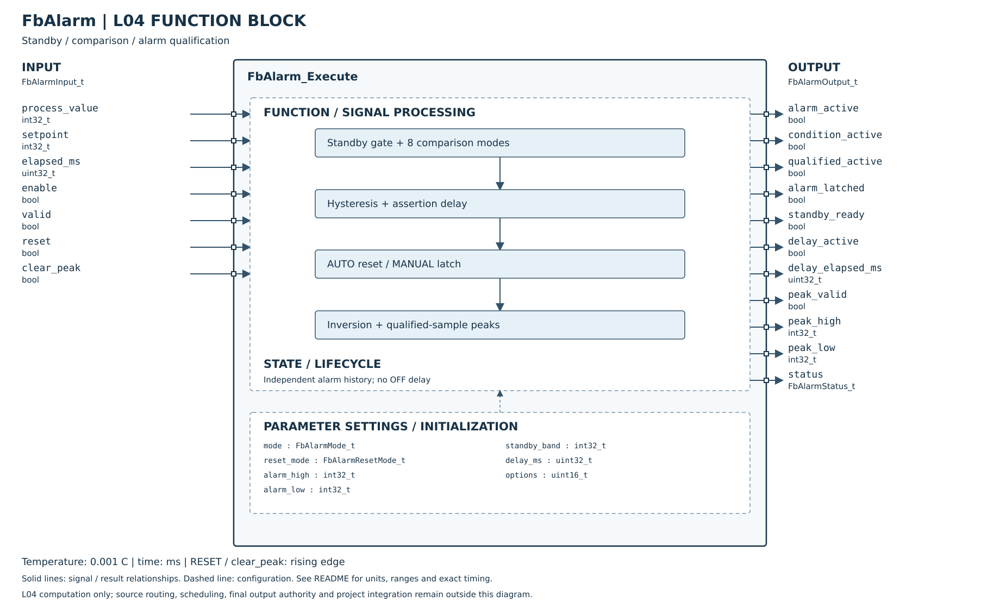

# FbAlarm Host Unit Test

## 摘要

- 日期：2026-10-22。
- 結果：PASS，13 組 Host 測試；溫度刻度 0.001°C，待機帶可設定，AUTO／MANUAL 解除及獨立峰值清除。
- 驗證：嚴格 C99（含 O2 最佳化），以及 AddressSanitizer／UndefinedBehaviorSanitizer。
- 範圍：八種比較、待機刻度、成立延遲、取消／重啟、自動解除、手動鎖存、Reset 接受／拒絕、獨立峰值清除、無效參數、設定變更、溢位與多實例。control_running 引腳已移除，STOP 不影響鎖存；L05／MCU 整合仍待驗證。
- 詳細規格與手冊／專案契約區分見 [FbAlarm README](../../README.md)。Host 結果不代表 MCU 實測或完整設備時序相容。
- 程式：[test_fb_alarm.c](../../../../../Tests/Unit/L04_FunctionBlock/test_fb_alarm.c)。

## 測試細則

| 測項 | 驗證內容 | 結果 |
|---|---|---|
| UT-01 | 六種非遲滯模式的 20 組門檻／等號案例，確認輸入與設定不修改。 | PASS |
| UT-02 | 遲滯高／低的動作、區間維持、解除及等號保留狀態。 | PASS |
| UT-03 | 待機 SV±100（±0.1°C）含邊界、±101 尚未解除、停用後重新待機。 | PASS |
| UT-04 | 首次觀察不回算 elapsed、99＋1 ms 到期、零 elapsed、超時、不固定週期、取消／重啟、100 秒最大值、無 OFF 延遲、多實例隔離。 | PASS |
| UT-05 | MANUAL 延遲成立才鎖存；異常仍在時 Reset 拒絕且計時不中斷；恢復後新上升緣接受；持續 Reset 不重試或阻擋新警報；Reset 保留峰值；雙命令同時清除；AUTO 正常即解除。 | PASS |
| UT-06 | 排除延遲前與純鎖存樣本、跨次峰值、clear_peak 上升緣、有效旗標、停用保留、反向正常 ON 不記錄。 | PASS |
| UT-07 | ENABLE 優先於無效設定、無效 PV 強制 OFF、模式 0＋全部選項不動作、錯誤恢復重新計時。 | PASS |
| UT-08 | 門檻順序、相對偏移交叉、負值允許與範圍拒絕、延遲上限、舊 HOLD bit／未知 reset_mode／mode 拒絕、NULL 與錯誤輸出。 | PASS |
| UT-09 | INT32 極值相對加減不溢位、參數變更清除舊計時與峰值。 | PASS |
| UT-10 | 待機＋遲滯＋延遲＋MANUAL＋反向＋峰值聯合流程、Reset 不重新待機且保留峰值、反向輸出照常處理、停用期間清除峰值。 | PASS |
| UT-11 | 25.123°C 絕對／相對門檻、負溫門檻、0.001°C 動作差異與遲滯、峰值保留三位、−200／3000°C 實際範圍。 | PASS |
| UT-12 | 預設 0.100°C、自訂 ±0.500°C 含邊界、零帶須等於 SV、帶寬變更清除保持與峰值並重新待機、非法範圍拒絕、未啟用時忽略、多實例隔離、INT32 極值運算。 | PASS |
| UT-13 | 遲滯區內仍拒絕 Reset；拒絕 Reset 不影響同時清峰值；條件仍成立時清峰值以當次 PV 重建；條件恢復後清峰值不解除鎖存；切換 AUTO 清除舊鎖存。 | PASS |

## 重現方式

在 Platform repository 根目錄執行：

```sh
cc -std=c99 -O2 -Wall -Wextra -Werror -pedantic \
  -I L04_FunctionBlock/Alarm \
  L04_FunctionBlock/Alarm/FbAlarm.c \
  Tests/Unit/L04_FunctionBlock/test_fb_alarm.c \
  -o /tmp/test_fb_alarm
/tmp/test_fb_alarm
```

記憶體與未定義行為檢查：編譯時另加 `-fsanitize=address,undefined -fno-omit-frame-pointer`。目前環境不支援 LeakSanitizer 的程序資訊讀取，執行時使用 `ASAN_OPTIONS=detect_leaks=0`；ASan／UBSan 維持啟用。此 FB 不使用動態記憶體。
