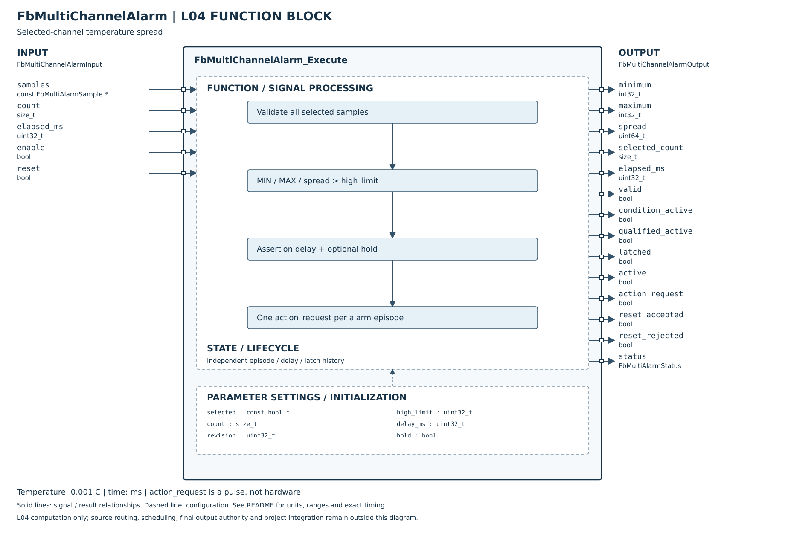

# FbMultiChannelAlarm

## 摘要

已完成 L04 單實例跨通道溫差警報：MAX−MIN、0～10000 ms 成立延遲、自動重新武裝或保持鎖存、獨立 Reset 上升緣及一次動作脈衝。Host 與 ASan／UBSan 驗證通過。L05 跨模組資料、動作目標／回報、Register／NVM／MCU 尚未接入。

此為本專案契約；DTDM04 沒有完整定義的 Reset、失效恢復及重複觸發行為不宣稱設備相容。單通道 FbAlarm 與本 FB 各自獨立，不能互相替代。

## 設定參數與引腳細則

| 類別 | 參數 | 定義 |
|---|---|---|
| Config | selected／count | 外部 bool 選取陣列及容量，至少選兩項；不綁定 8×4 通道 |
| Config | revision | 修改選取內容／來源身分時必須更新；呼叫期間保持所有設定不可變 |
| Config | high_limit | uint32，溫度單位 0.001°C；比較 spread>limit，等於不成立 |
| Config | delay_ms | 0～10000 ms，0 即時；沒有解除延遲 |
| Config | hold | false：正常後重新武裝；true：保持並等待接受 Reset |
| Input | samples／count | 每筆 int32 value／bool valid，count 必須與 Config 相同 |
| Input | elapsed_ms | 自上次 Execute 的實際時間；首次觀察成立從0開始，不倒算先前時間 |
| Input | enable | false：所有輸出零／無效，狀態 DISABLED，清除全部歷史 |
| Input | reset | 上升緣；只在本次資料有效且 condition=false 時接受 |
| Output | minimum／maximum／spread | 選定來源極值與 uint64 差值；無效時零 |
| Output | selected_count | 本次選中數量；不是有效來源數量 |
| Output | condition_active | 原始嚴格比較條件，本次資料無效時 false |
| Output | qualified_active／elapsed_ms | 延遲後成立及目前累計時間；失效取消未完成計時 |
| Output | latched／active | 保持鎖存／qualified或latched；無效資料期間可保留 latch，但 valid=false |
| Output | action_request | 新成立一次脈衝，只維持一個呼叫；不等於動作已執行成功 |
| Output | reset_accepted／reset_rejected | 本次 Reset 上升緣受理結果；持續高不重試 |
| Output | valid／status | valid 表示本次比較資料有效；OK／DISABLED／INVALID_ARGUMENT／INVALID_CONFIG／INVALID_INPUT |

建議產品初始設定可用 high_limit=10000（10°C）、delay_ms=1000、hold=false，依使用者設定選取來源；不提供隱含預設通道選擇。陣列由呼叫端提供，不配置 heap。實例使用零初始化或 Init。

## 運作及重新武裝

當選定來源皆有效，找出極值；以 int64 差值轉 uint64，包含 INT32_MIN～INT32_MAX 的差 4294967295。任何選中來源 valid=false，整次比較無效；未選中來源可失效而不影響比較。不跳過失效來源以免漏掉真正極值。

成立首筆 pending 從0開始；之後仍成立才累計 elapsed_ms，飽和於 delay_ms，避免溢位。0延遲首筆直接成立。條件正常立即清除 qualified 與計時。hold=false 每一個經有效正常條件分隔的成立週期只發一次 request；hold=true 首次成立鎖存，條件正常也不清除。

Reset 在有效且條件正常時才清除 latch 與已觸發紀錄；有效但條件成立、或無效資料時拒絕。Reset 被拒絕後維持高不會於條件恢復時自動重試，必須拉低再拉高。正常條件下 reset=true 不會順便清除峰值，因本 FB 沒有峰值記錄。

## 失效、設定變更與生命週期

- 資料失效取消計時與 qualified，保留 fired／latched；恢復時若仍超差，重新跑延遲，但既有 fired 不再送 request。
- 非保持模式在恢復後觀察到一次有效正常才重新武裝；保持模式必須接受 Reset。
- 無效設定亦取消計時並保留 fired／latched，不把配置錯誤當人工 Reset。
- 合法設定的指標、容量、revision、門檻、延遲或 hold 改變會建立新週期，清除舊 latch／fired；因此參數套用與 disable／enable 皆可能允許再次動作，外層必須依既有配置權限管理。
- selected 內容不複製，呼叫端需在內容／來源身分變更時更新 revision。修改陣列卻不更新 revision 違反契約。不得在呼叫期間修改／釋放陣列或讓輸入、設定、實例、輸出記憶體重疊。
- NULL output 只回 INVALID_ARGUMENT；其他必要頂層指標缺漏時清零輸出、不改狀態。缺 samples／count不符回 INVALID_INPUT 並取消計時。

active 可能在 valid=false 時仍為 true，代表先前鎖存仍存在，不代表本次數值比較有效。消費者必須一起讀 valid/status；不得因斷線而將既有警報視為已正常解除。

## 外層責任與待接入

L05 將模組 mask 轉為來源陣列，保證同單位、同尺度、資料年齡與取樣時間差；同一物理來源重複出現不由 L04 偵測。不同專案可配置不同數量，不將 Master／Slave、站號或 CAN PDO 放進 L04。

Action 編號、目標迴路、唯一動作擁有者及命令佇列由既有 SYSTEM／L05 管理。request 不內建重試／ACK／持久化去重，SYSTEM 需即時接收並記錄執行結果，不能每週期用 active 反覆執行 Toggle 或 PID Group+1。Reset 本 FB 不等於重置單通道警報；兩者使用獨立命令。

既有 SYSTEM／Safety／輸出服務保留最終許可；本 FB 不寫硬體、不操作 RUN／STOP。[Host 驗證細則](HOST_TEST.md)。

## SVG FBD 維護說明

2026-10-26：方塊圖已依 [公開 Header](../FbMultiChannelAlarm.h) 核對。左側為輸入、右側為輸出，外框內為功能分組與參數設定；Init／Reset 的資源與初值另列，不代表新增執行引腳。標示 API result 的列是函式回傳值，非 Output 結構成員。內部箭頭表示功能關係，精確優先序與錯誤行為以程式及本文契約為準。圖面使用英文介面名稱，說明沿用本頁繁體中文文件。
