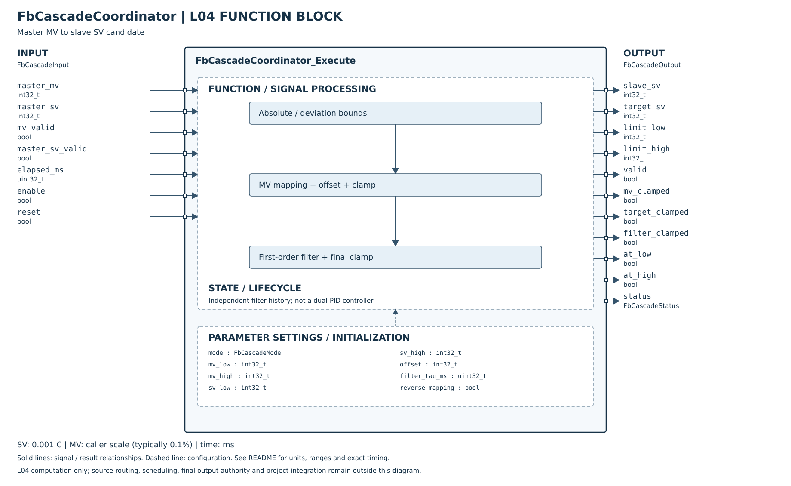

# FbCascadeCoordinator

## 摘要

已完成 L04 主控 MV→副控 SV 換算核心及 Host／ASan／UBSan 驗證：絕對／偏差模式、可設定MV範圍、正反映射、Offset、限幅與一階時間濾波。演算法是本專案明訂契約，不宣稱已確認 DTDM04 的完整公式或Filter Num語意。

此為串級的一個元件，不是兩個PID與全部串級功能已整合。L05單／串級切換、主副執行順序、AT／校準、anti-windup協調、副控保護及Register／NVM／MCU尚未完成。輸出僅為副控SV候選，不改變SYSTEM／Safety最終輸出權責。

## 參數及引腳細則

| 類別 | 欄位 | 定義 |
|---|---|---|
| Config | mode | ABSOLUTE或DEVIATION；其他拒絕 |
| Config | mv_low／mv_high | int32且low<high；常用0～1000代表0～100.0%，不寫死後端MV尺度 |
| Config | sv_low／sv_high | int32且low≤high；溫度0.001°C。絕對模式是SV界限，偏差模式是相對主控SV的偏差 |
| Config | offset | 映射後的SV補償，0.001°C；不把百分比與溫度相加 |
| Config | filter_tau_ms | uint32；0旁路；是明確時間常數，不是DTDM04 0～60的Filter Num |
| Config | reverse_mapping | false：MV低→SV低；true：MV低→SV高 |
| Input | master_mv／mv_valid | 主控計算結果與有效性；無效即清除歷史與回無效 |
| Input | master_sv／master_sv_valid | 偏差模式的基準，必須有效；絕對模式忽略 |
| Input | elapsed_ms | 濾波實際時間；有濾波且dt=0保持舊濾波值，仍套用新界限 |
| Input | enable／reset | enable=false優先清除歷史，零／無效／DISABLED；reset為電位有效，該次零／無效／RESET |
| Output | slave_sv／target_sv | 濾波後副控SV候選／Offset與限制後的濾波目標 |
| Output | limit_low／limit_high | 本次絕對SV界限 |
| Output | mv_clamped／target_clamped／filter_clamped | MV超範圍／Offset後目標越界／濾波歷史因移動界限被夾制 |
| Output | at_low／at_high | 最終整數SV等於對應界限；兩界相等時皆true，不代表實體副控MV飽和 |
| Output | valid／status | OK、DISABLED、RESET、INVALID_ARGUMENT、INVALID_CONFIG、INVALID_INPUT；非OK結果清零 |

DefaultConfig為偏差模式、MV0～1000、SV偏差-10000～60000（-10～+60°C）、Offset0、濾波旁路、正向映射。這是安全明確的初始化資料，不表示產品已啟用串級或自動套用此範圍。實例先Init或零初始化。

## 計算順序與公式

1. 計算界限：ABSOLUTE用[L,H]；DEVIATION用[master_sv+L, master_sv+H]。若加總超出int32，回INVALID_INPUT，不無聲飽和。
2. MV夾到設定範圍。令p=MV−MV_low、span=MV_high−MV_low；反向時p=span−p。
3. 映射SV=low+floor(p×(high−low)/span)。無負的乘積，採uint64容納完整int32範圍；整數映射朝low取整，端點精確。
4. 加Offset，再夾至本次SV上下界。
5. 首筆有效值直接種入濾波狀態；後續tau>0採Backward Euler：y=y+dt/(tau+dt)×(target−y)。內部double保存小數，避免整數細小變動永久卡住。
6. 濾波後再夾到本次移動界限，再轉int32（朝零取整）。tau=0每次直接跟隨目標。filter_clamped表示界限限制歷史，不是MV輸出保護。

例如主控SV=220000、偏差[-20000,40000]、MV範圍[0,1000]，MV=0／500／1000分別映射副控SV=200000／230000／260000，即200／230／260°C。Offset必須仍受本次界限限制。

## 狀態與整合限制

設定任何欄位變更、disable、reset、無效輸入或無效設定，都清除濾波歷史；恢復首筆重新種入，不沿用舊值。故障及設定變更後可能發生SV跳變，不宣稱無擾切換。更改主控SV不是Config變更，濾波歷史保留，但新的偏差界限會立即限制它。

每個實例獨立，無動態配置、全域可變狀態或CKLIB引用。參數、輸入、輸出、狀態記憶體不得重疊並於呼叫期間保持穩定。NULL output只回INVALID_ARGUMENT；其他頂層NULL在有output時清零，不改變實例。

L05需先明確指定主控哪個MV：加熱冷卻雙輸出不可自行取第一個或直接相減；映射方向與量綱亦由產品設定。L04 FbPid目前PV／SV仍為0.1°C，接入前需完成顯式轉換，不能直接傳本FB的milli°C數值。

副控PV過溫保護、Sensor失效、控制許可由既有SYSTEM／Safety處理，本FB不把SV限幅當PV保護。主控積分追蹤、實際副控飽和回授、AT主副移交及一鍵校準亦尚未實作；at_low／at_high只是SV位置，不能據此假裝已完成anti-windup。

[Host測試細則](HOST_TEST.md)。

## SVG FBD 維護說明

2026-10-26：方塊圖已依 [公開 Header](../FbCascadeCoordinator.h) 核對。左側為輸入、右側為輸出，外框內為功能分組與參數設定；Init／Reset 的資源與初值另列，不代表新增執行引腳。標示 API result 的列是函式回傳值，非 Output 結構成員。內部箭頭表示功能關係，精確優先序與錯誤行為以程式及本文契約為準。圖面使用英文介面名稱，說明沿用本頁繁體中文文件。
