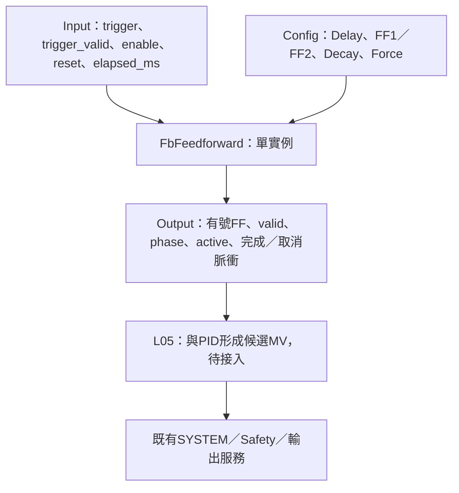

# FbFeedforward

## 摘要

已完成 L04 事件觸發前饋及Host／ASan／UBSan驗證：延遲、兩階段步階／指數、第三階段線性回零、強制截止時間與事件邊緣／位準。演算法為明確專案契約，不宣稱與DTDM04未公開的曲線及重觸發行為相同。

只產生FF補償量，不執行SYSTEM Event、不呼叫PID或寫輸出。L05事件串接、PID加總與熱冷分配、Register／NVM／MCU尚未完成。

## Config與引腳

| 欄位 | 定義 |
|---|---|
| delay_ms | 觸發到第一階段延遲，0～3000000ms |
| stage1／stage2.duration_ms | 各0～3000000ms；0跳過，不套用該段target |
| stage1／stage2.target | 有號0.1%，-1500～1500即-150～150%；不是硬體Duty |
| stage1／stage2.shape | STEP或EXPONENTIAL |
| stage1／stage2.tau_ms | 指數時間常數；有效指數段需1～3000000ms。STEP或零時間段忽略tau |
| decay_ms | 第三階段由前段實際值線性回零，0～3000000ms；0立即完成 |
| force_ms | 0依事件位準；1～3200000ms為從觸發開始的硬截止時間，含delay |
| input.trigger／trigger_valid | 外層提供事件位準與有效性，FB不認識來源或站號 |
| input.elapsed_ms | 實際執行間隔，首個trigger edge忽略前置dt |
| input.enable | false立即零／invalid／DISABLED並清歷史；再啟用遇高位準可視為新edge |
| input.reset | 電位有效，每次true都清除；消耗當前trigger位準，避免Reset後持續高自動再啟動 |
| output.value／valid | 有號0.1%補償；OK時IDLE／DONE亦valid=true且值0；錯誤／停用／Reset均零且invalid |
| output.phase／active | IDLE、DELAY、STAGE1、STAGE2、DECAY、DONE；delay到decay屬active |
| output.elapsed_ms | uint64自觸發的已消耗時間；完成後保留最後呼叫時刻，可大於精確截止點 |
| output.started／completed／aborted | 單次呼叫脈衝，不是永久狀態；全零配方可同次started且completed |
| output.status | OK／DISABLED／RESET／INVALID_ARGUMENT／INVALID_CONFIG／INVALID_INPUT |

DefaultConfig全部零，兩段STEP，為合法但沒有補償的配方；無預設觸發來源。實例零初始化或Init，每個實例獨立；無heap或可變全域狀態。所有設定／輸入／輸出／狀態不可重疊，呼叫期間不可變動。

## 波形與時間契約

波形順序 Delay→Stage1→Stage2→Decay→Done。Step於段進入時立即到target並維持該段時間。Stage1從0開始，Stage2從Stage1段末實際值開始；跳過Stage1則Stage2從0開始，跳過Stage2則Decay沿用Stage1末值。

指數段採有限段正規化公式：

`y(t) = start + (target-start) × (1-exp(-t/tau)) / (1-exp(-T/tau))`

T為該段duration，t在[0,T]，段末精確接至target；實作用expm1減少小比例時相消誤差。不是把T默認為tau。第三段採`start×(1-t/T3)`回零，負補償亦正確朝0。內部double，輸出朝零取int32；不因顯示為0就代表active已結束。

段時序依總elapsed直接定位，無跨段迴圈；大dt可直接越過多段。恰好到邊界立即進下一個非零時間段；全零段不產生一次呼叫的尖峰。正常完成後value=0，不保留最後target。

## Event／Force／取消

- trigger上升緣啟動；運行中新的上升緣忽略，不重啟、不延長。DONE後持續高也不重跑，需重新低→高。
- force_ms=0時，執行期間trigger低立即取消，補償歸零，不改走Decay；這是專案取消政策。
- force_ms>0時，事件低仍繼續正常波形；達到force硬截止則歸零並aborted。force包含delay，因此force<delay可能完全不輸出補償。
- 波形比force早結束時正常completed、歸零；不等待force、不維持非零值。若force恰好等於波形總長，記正常完成。
- 同一大dt跨過波形與force時，依兩者較早的終點決定completed或aborted，不以本次落點猜測先後。
- 合法Config改變會取消並清零，採新Config但消耗當前trigger，需新低→高。失效trigger或無效設定也取消，恢復時持續高不自動再啟動。Reset相同。
- enable=false優先於Reset／數值驗證；必要頂層NULL最先回INVALID_ARGUMENT，不更動實例，有output時清零。停止／失效的aborted只在原來active時發一次。

本FB的reset是電位有效，與一般Alarm的Reset上升緣不同，外層不得用同一假設代替各FB契約。

## 待接入責任

SYSTEM提供事件來源，L05決定通道與實例。FF加PID時保留有號及足夠位寬，不能先把負FF夾成0；最終限幅／Safety仍獨立。加熱冷卻雙輸出要補償MV1、MV2或合成有號控制量，仍需產品定義；手動／AT／Cascade期間是否允許及飽和後anti-windup追蹤亦尚未完成。

輸出completed／aborted不等於命令已被SYSTEM受理，必要時由外層佇列與回報。Register時間100ms轉固定ms，曲線tau為專案新參數，不能直接沿用未定義位址；Pending／Apply與NVM由既有服務處理。MCU數學庫、資源及實際波形仍待驗證。

[Host測試細則](HOST_TEST.md)。
