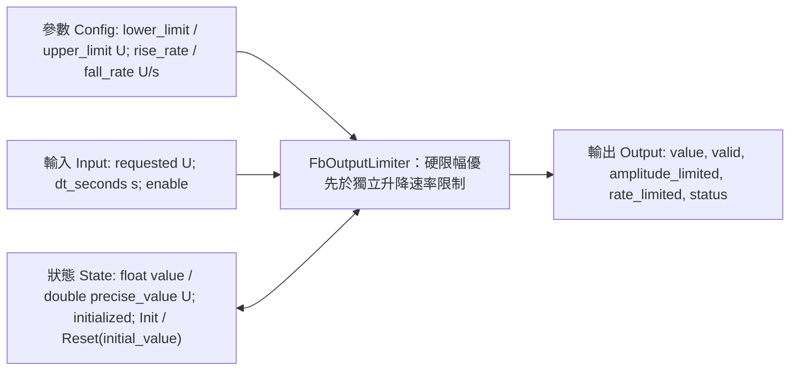

# FbOutputLimiter Host 單元測試



## 介面細則

- 訊號、Config/Input/Output 數值欄位及初值使用 `float`，符合 float32 製程訊號；差值及速率乘時間前先轉為 `double`。Host 使用 IEEE binary32/binary64；移植時須確認 double 可容納 float 範圍的平方，標準 binary32/binary64 組合符合此條件。
- Config 上下限為有限值，單位 U，且 lower <= upper。相等上下限代表固定輸出。升降速率分開設定，單位 U/s，須有限且非負；零代表保持，不代表無限制。
- Input requested 單位為 U；dt_seconds 由呼叫端提供秒數，啟用時須有限且非負。零時間保持，但仍可強制修正硬限幅。沒有任意 dt 上限；極大有限時間會到達限幅後目標，不超越目標。
- `Init(State*, float)` 與 `Reset(State*, float)` 相同：立即將有限初值寫入 value 與 precise_value；直到 Execute 有有效 Config 才限幅。非法初值不修改原 State。
- Execute 依序驗證指標、設定、已初始化狀態及啟用時的輸入；將舊狀態與 requested 限制於目前上下限，再從修正後狀態以保留的 double 累積值執行斜率限制。縮緊硬限幅時，硬限幅優先，即使 dt 或速率為零仍修正。
- `enable=0` 忽略 requested/dt，套用有效硬限幅，其餘保持 State；回傳 DISABLED、valid=0。重新啟用時只使用新 dt，不累積停用時間。
- Output `amplitude_limited` 表示本週期舊狀態或 requested 需要限幅。`rate_limited` 表示內部 precise_value 尚未等於限幅後目標，即使四捨五入後的 float 輸出已相等。停用時 rate_limited=0。
- State 保留 `double precise_value`，避免每週期 float 四捨五入造成停滯。轉回 float 前，拒絕非有限、超出 float 範圍或與公開 value 不一致的累積值。旗標及 enable/initialized 使用 C99 `bool`。
- 回傳狀態同步寫入 Output：OK、INVALID_ARGUMENT（空指標）、INVALID_CONFIGURATION、INVALID_INPUT、INVALID_STATE、DISABLED。錯誤輸出無效、旗標清除，數值為已初始化且有限的保持值，否則零。錯誤不修改 State，因此診斷輸出不保證符合新提供的上下限；不可用無效輸出驅動控制。
- 呼叫端持有互不重疊且有效的 Config/Input/State/Output，並須先初始化 State。零初始化 State 可安全驗證未初始化路徑，任意未初始化的 C 儲存不可。不可直接修改 State 欄位。未新增 L03/L05、硬體、Register Map 或 NVM 串接。

## 摘要

- 結果：PASS，`Tests/Unit/L04_FunctionBlock/test_fb_output_limiter.c` 共 25 個編號測試群組。
- 環境：Linux x86_64、GCC 14.2.0，嚴格 C99，`-Wall -Wextra -Werror -pedantic`。
- AddressSanitizer + UndefinedBehaviorSanitizer：停用漏記憶體偵測後 PASS。預設 LeakSanitizer 因執行環境使用 ptrace 而失敗，並非偵測到程式漏記憶體。本 FB 無動態配置。
- 嚴格 `-O0` 編譯與執行不需要 `-lm`，使用有限值三元比較取代 fmin/fmax。
- C++11 呼叫端包含 Header 並連結獨立以 C99 編譯的 object：PASS，驗證 extern-C 連結。
- 嚴格編譯及 sanitizer 實際輸出皆為：`FbOutputLimiter host tests passed (25 cases); sizes: config=16 input=12 state=24 output=12`。

## 實際測試細則

以下 25 個測試群組全部通過。

| 案例 | 實際操作 | 預期且實測結果 |
|---|---|---|
| UT-01 | 對零初始化 State 執行 Execute，再 Init(0) | INVALID_STATE；Init OK、initialized=1、value=0 |
| UT-02 | requested=8、rise=2 U/s、dt=0.5 s，兩次 | 依序 1、2，rate_limited=1 |
| UT-03 | 由 2 請求 -8、fall=4 U/s、dt=0.5 | 輸出 0，確認獨立下降速率 |
| UT-04 | 由 0 請求 1；重複；再請求 0.5 | 精確 1、保持 1、精確 0.5；不超越、無速率旗標 |
| UT-05 | 上下限 ±10，請求 ±99 | 初次輸出 1.5，兩旗標皆設；大 dt 到達 ±10，只有限幅旗標 |
| UT-06 | 由 -10 朝 0，dt=0 再 0.5 | 保持 -10，再 -9；不累積時間 |
| UT-07 | 先零上升率，再零下降率 | 兩方向各自保持 -9 |
| UT-08 | 零速率／時間時縮限至 ±2；Reset(9) | State -9 強制變 -2；State 9 強制變 2；硬限幅優先 |
| UT-09 | 上下限同為 1，請求 1 | 立即為 1；下一個恰在邊界的週期沒有任何限制旗標 |
| UT-10 | 停用、requested=NaN、dt=-Infinity、State=9、上下限 [1,1] | DISABLED、無效、State/output=1；只有首次修正設限幅旗標 |
| UT-11 | 恢復啟用，上下限 ±10、target=8、dt=0.5 | 由 1 到 2，只用目前 dt |
| UT-12 | requested/dt 各測 NaN/+Infinity/-Infinity，另測 dt=-1 | INVALID_INPUT；State 保持 2、輸出無效保持值、旗標清除 |
| UT-13 | 每個 Config 欄位分別測 NaN/+Infinity/-Infinity | INVALID_CONFIGURATION，State 保持 2 |
| UT-14 | 停用時測 lower>upper、負 rise、負 fall | 三者皆 INVALID_CONFIGURATION |
| UT-15 | Execute 每個指標分別為 NULL；Init/Reset State=NULL | INVALID_ARGUMENT；原 State 保持 2，空 State 時輸出零 |
| UT-16 | Init/Reset 各測 NaN/+Infinity/-Infinity | INVALID_INPUT；保留已初始化 State/value |
| UT-17 | initialized=false，再 State value=NaN；有效 Reset(0) | INVALID_STATE、無效零診斷；Reset 後恢復，下一次輸出 1 |
| UT-18 | 第二實例由 -5 前進到 -4；第一實例重設為 3 | 各自保存歷史，不影響其他實例 |
| UT-19 | 上下限 ±FLT_MAX、速率及 dt=FLT_MAX、目標為相反極值 | 兩方向精確到 ±FLT_MAX；有限、不溢位或超越 |
| UT-20 | 由 -FLT_MAX 朝 FLT_MAX，以 FLT_MAX U/s 執行 1 s；再用 FLT_MIN 速率 | 精確到中點 0；再正向移動 FLT_MIN，設速率旗標 |
| UT-21 | 100000 週期：32000 朝 32001、rate=.001、dt=.01 | 公開輸出到 32001；累積值 >32000.99，無逐週期 float 捨入停滯 |
| UT-22 | 反向 100000 週期，再 Reset(32000) | 公開輸出回到 32000；重設清除累積小數歷史 |
| UT-23 | dt=0 時縮緊上限至 31999；破壞累積值／一致性 | 兩值強制為 31999；拒絕不一致／非有限累積值 |
| UT-24 | 累積值設為 double(FLT_MAX)*2 | float 轉型前回報 INVALID_STATE |
| UT-25 | 32000 執行一次小數增量，再停用／零 dt／零 rise；縮上限至 32000 | 保持期間保留小數；硬限幅清除小數並設限幅旗標 |

## 記憶體與重設

所有儲存由呼叫端持有，固定大小，每週期 O(1)。不使用 heap、buffer、靜態可變狀態或外部資源。Host ABI 實測：Config 16 bytes、Input 12 bytes、State 24 bytes、Output 12 bytes，分開儲存的實例與介面合計 64 bytes。大小可隨 ABI 改變，MCU 請以 sizeof 確認。Reset 同步 value 與 precise_value 並設定 initialized；非法 Reset 保留兩值。下一次有效 Config 的 Execute 套用目前上下限，停用時亦同。

## 重現指令與限制

在 repository 根目錄執行：

```sh
cc -O0 -std=c99 -Wall -Wextra -Werror -pedantic \
  -I L04_FunctionBlock/Control \
  Tests/Unit/L04_FunctionBlock/test_fb_output_limiter.c \
  L04_FunctionBlock/Control/FbOutputLimiter.c \
  -o /tmp/test_fb_output_limiter
/tmp/test_fb_output_limiter

cc -O0 -std=c99 -Wall -Wextra -Werror -pedantic \
  -fsanitize=address,undefined -fno-omit-frame-pointer \
  -I L04_FunctionBlock/Control \
  Tests/Unit/L04_FunctionBlock/test_fb_output_limiter.c \
  L04_FunctionBlock/Control/FbOutputLimiter.c \
  -o /tmp/test_fb_output_limiter_san
ASAN_OPTIONS=detect_leaks=0 /tmp/test_fb_output_limiter_san

cc -O0 -std=c99 -Wall -Wextra -Werror -pedantic \
  -I L04_FunctionBlock/Control -c L04_FunctionBlock/Control/FbOutputLimiter.c \
  -o /tmp/fb_output_limiter.o
printf '#include "FbOutputLimiter.h"\nint main() { FbOutputLimiterState s = {}; return FbOutputLimiter_Init(&s, 0.0f); }\n' | \
  c++ -std=c++11 -Wall -Wextra -Werror -pedantic \
  -I L04_FunctionBlock/Control -x c++ - -x none /tmp/fb_output_limiter.o \
  -o /tmp/test_fb_output_limiter_cpp
/tmp/test_fb_output_limiter_cpp
```

預設 sanitizer 執行回報 `LeakSanitizer has encountered a fatal error` 及 `LeakSanitizer does not work under ptrace (strace, gdb, etc)`。僅停用漏記憶體偵測後重試通過，address/undefined 檢查仍啟用。初次合併 C/C++ 的指令將 `-std=c++11` 套用至 C 輸入，遭 `-Werror` 拒絕；依上述指令分別編譯 C、連結 C++ 後通過。

未驗證：MCU 時序、目標編譯器浮點 ABI、硬體／閉迴路行為或長時間累積精度。double 累積值可保留小於 float 解析度的增量，但小於 double 解析度的增量仍可能停滯。公開 float 輸出會量化，單週期位移可能比 rate×dt 多最多一個當地 float ULP；不保證定點精度。非預設 fast-math/flush-to-zero 建置不在本次結果範圍內。環境未安裝 cmake，因此未執行 CMake/CTest；使用上述直接編譯驗證。
