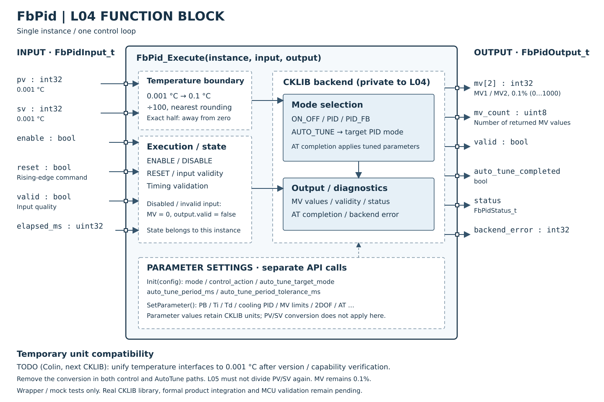

# FbPid 功能方塊、引腳與參數說明

## 摘要

**完成狀態（2026-10-27 用語統一）：L04 封裝完成；Host mock 單元測試通過。**

| 追蹤項目 | 狀態 |
|---|---|
| 產品串接 | 部分完成：L05 adapter 與 mock 串接已有測試紀錄；正式 PID provider／callback、實體庫及輸出鏈未完成 |
| MCU 實測 | 尚未實測 |

狀態用語見 [完成狀態與驗證定義](../../VERIFICATION_STATUS.md)；[L05 PID adapter 測試與限制](https://github.com/ch7lin-cyber/myNXPs16_Prj/blob/branch2_ver1/_Product/Docs/L05_PID_CONTROLLER_ADAPTER.md)。本次為文件整理，不代表重新執行測試。

2026-10-25：公開FbPidInput_t與L05 provider的PV／SV統一採int32、0.001°C。目前CKLIB仍使用0.1°C，暫時在FbPid.c的ToCklibTemperature單一邊界轉換，L05不得先除100。MV保持0.1%，時間與SetParameter設定值不因這次PV／SV引腳變更而自動改刻度。

**下一版待Colin將CKLIB的溫度介面統一為0.001°C；實際版本／能力確認後才移除相容轉換。** 此為待辦，不是目前後端已支援或可達0.001°C控制解析度的宣告。

2026-10-26：補齊 5 個初始化設定欄位、26 個 SetParameter 項目及操作規則。以下區分「L04 已檢查」、「CKLIB 檔頭描述」與「待確認」；DTDM04 Register 的範圍、預設值及時間選項不直接視為目前 CKLIB 的規格。

## 方塊圖與引腳

2026-10-26：SVG 範例依 `FbPid.h` 的正式介面繪製。外框代表單一 `FbPid_t` 實例，左側為每次 Execute 的輸入，右側為輸出；內部虛線框為功能分組。底部設定框對應 Init／SetParameter API，並非每次執行的輸入引腳。內部線條表示功能關係，詳細執行順序仍以程式為準。

| 方向 | 欄位 | 型別／單位 | 說明 |
|---|---|---|---|
| 輸入 | pv、sv | int32；0.001°C | 量測值、設定值；L04 暫轉 CKLIB 0.1°C |
| 輸入 | enable | bool | 禁能時 MV 歸零，輸出 valid=false |
| 輸入 | reset | bool | 上升沿重置命令 |
| 輸入 | valid | bool | 輸入資料有效性 |
| 輸入 | elapsed_ms | uint32；ms | 本次執行的時間步長 |
| 輸出 | mv[2] | int32；0.1% | MV1／MV2，0～1000 |
| 輸出 | mv_count | uint8 | 後端回傳的有效 MV 數量 |
| 輸出 | valid | bool | 運算輸出有效性 |
| 輸出 | auto_tune_completed | bool | 自整定完成並移交控制器 |
| 輸出 | status | FbPidStatus_t | FB 執行狀態 |
| 輸出 | backend_error | int32 | CKLIB 錯誤碼 |

設定包含四種模式、控制方向、AT 目標 PID 模式與週期／容許誤差；個別 PID／ON_OFF／AT 參數透過 `FbPid_SetParameter()` 設定，其適用模式與刻度須依 CKLIB 規格。SVG 可隨程式版本一起維護；修改公開介面時須同步更新圖與本表。

## 初始化設定：FbPidConfig_t

使用 `FbPid_Init(&instance, &config)` 建立後端物件。這些欄位在初始化時複製至實例，沒有執行中切換模式的公開 API；需要切換時，先停止外層使用輸出，再 Deinit／Init 並重新設定參數。不要直接修改 `instance.config`，也不要對已初始化的實例重複 Init，以免遺失後端資源。

| 設定欄位 | 用途 | 可設定值／單位 | 檢查與使用條件 |
|---|---|---|---|
| `mode` | 選擇本實例的控制算法 | 0=`AUTO_TUNE`；1=`ON_OFF`；2=`PID`；3=`PID_FB`，使用 `FB_PID_MODE_*` 列舉 | L04 拒絕範圍外的值。AUTO_TUNE 建立自整定及目標控制器，其餘建立所選控制器 |
| `control_action` | 選擇加熱、冷卻或加熱／冷卻雙輸出 | 0=`HEAT`；1=`COOL`；2=`HEAT_COOL`，使用 `FB_PID_ACTION_*` | L04 檢查列舉範圍。單向控制使用 `mv[0]`；雙向控制依 CKLIB 定義為 `mv[0]` 加熱、`mv[1]` 冷卻 |
| `auto_tune_target_mode` | 自整定完成後，接手運算的控制器類型 | AUTO_TUNE 時只允許 `PID` 或 `PID_FB` | 其他模式仍會檢查此欄位是否為有效模式列舉，但不使用它建立控制器；建議填 `PID` |
| `auto_tune_period_ms` | AT 呼叫時間步長的檢查基準 | uint32，ms；AUTO_TUNE 時須 ≥10 | 此欄位不建立排程器，也沒有傳入 CKLIB 的 AT 週期設定 API；實際呼叫週期由 L05 提供。後端實際採樣假設仍須確認 |
| `auto_tune_period_tolerance_ms` | 容許 AT 每次呼叫步長偏離基準的程度 | uint32，ms；0 表示必須完全相同 | 條件為 `abs(elapsed_ms - auto_tune_period_ms) <= tolerance`。目前無額外上限檢查，應依實際排程抖動設定，不能藉此宣稱後端支援任意抖動 |

例如 AT 基準為 100ms、容許誤差為 10ms，90～110ms 可通過 L04 檢查；89ms 或 111ms 回報 `INVALID_TIMING` 並清空輸出。即使 AT 已完成、改由目標 PID 控制，因實例 mode 仍為 AUTO_TUNE，這項時間檢查也會繼續執行。

`FbPid_Init()` 沒有替所有數值參數寫入產品預設值；未呼叫 SetParameter 的值取決於後端建立物件時的預設，不能假定等同 DTDM04 出廠設定。`PID_FB` 檔頭僅提供建立函式，目前 wrapper 沿用 PID 參數代碼；其與 PID 的算法差異及完整參數相容性待實體庫確認。

## 個別參數：FbPid_SetParameter

呼叫方式為 `FbPid_SetParameter(&instance, FB_PID_PARAMETER_名稱, value)`。下表名稱省略共同前綴 `FB_PID_PARAMETER_`，共有 26 項。API 的 value 一律為 int32；標為「無號」的項目由 L04 拒絕負值後，轉交 CKLIB 無號 setter；布林值則以 0=false、任何非零=true 轉交，使用端應固定傳 0／1。

**只有 Execute 的 PV／SV 會自動從 0.001°C 轉為 0.1°C。下列所有 SetParameter 值均原值轉交，沒有除 100、毫秒轉秒或 Register 刻度轉換。** 檔頭未註明的單位不能由參數名稱推定為已確認；特別是 PID PB、Deadband、ON_OFF 感度須取得 Colin 的規格後再完成產品參數映射。

### ON_OFF 與共用死區（3 項）

| 參數 | 功能與調整效果 | 適用模式 | 單位／範圍與限制 |
|---|---|---|---|
| `ON_OFF_OUT1_TS` | 輸出 1 切換感度／遲滯，用於避免 PV 在 SV 附近反覆切換；感度越大，允許的切換差距越大 | ON_OFF；單向加熱／冷卻均用輸出 1 | 有號原值。檔頭未明訂此欄位單位及上下限；與後端 PV／SV 的刻度關係待確認，不能直接傳 milli°C |
| `ON_OFF_OUT2_TS` | 輸出 2 的冷卻切換感度 | ON_OFF 且 HEAT_COOL | 有號原值。檔頭未明訂單位、範圍及等號邊界；單向模式不應依賴此參數 |
| `DEADBAND` | 加熱與冷卻間的中性區；用來協調兩側輸出。負值是否允許及重疊區的行為須依後端規格 | ON_OFF／PID，且 HEAT_COOL；PID_FB 參數相容性待確認 | 有號原值。L04 按實際控制器類型選擇 ON_OFF 或 PID 參數代碼；未檢查數值範圍，檔頭未明訂刻度 |

ON_OFF 檔頭描述雙向零輸出區為 `SV - DEADBAND/2 - OUT1_TS <= PV <= SV + DEADBAND/2 + OUT2_TS`。這是檔頭文字所述的區間，完整切換歷史、奇數除法、負死區及邊界行為尚無實體庫驗證，不以此宣稱已確認完整遲滯真值表。

### PID 核心與冷卻側（6 項）

下列 PID 設定也會寫入 AUTO_TUNE 實例內的目標控制器；AT 完成時套用整定結果可能改寫其中的參數。PID_FB 目前使用相同代碼轉交，但後端支援情況仍待確認。

| 參數 | 功能與調整效果 | 適用模式 | 單位／範圍與限制 |
|---|---|---|---|
| `PB` | 主輸出比例帶；檔頭說明數值越小，比例作用越強 | PID／PID_FB／AT 目標控制器 | 無號原值；檔頭未明訂溫度刻度、範圍或 0 的行為。不可直接把公開 milli°C 或 DTDM04 Register 原值視為正確後端值 |
| `TI` | 主輸出積分時間；數值越小，積分反應越快 | 同上 | 無號；目前 PID 檔頭標為秒。PDOF 說明將 Ti=0 定義為停用積分；最大值未載明。DTDM04 的 1s／100ms／10ms 選項尚未在此 API 實作 |
| `TD` | 主輸出微分時間；檔頭說明數值越大，微分作用越強 | 同上 | 無號；目前 PID 檔頭標為秒，上下限及 Td=0 的後端行為未明訂 |
| `COOL_PB` | 冷卻側比例帶 | 同上且 HEAT_COOL | 無號；檔頭指定冷卻用途，但未明訂刻度、範圍與 0 的行為 |
| `COOL_TI` | 冷卻側積分時間 | 同上且 HEAT_COOL | 無號；檔頭未獨立註明刻度與範圍，是否完全沿用主側秒制及零值語意待確認 |
| `COOL_TD` | 冷卻側微分時間 | 同上且 HEAT_COOL | 無號；檔頭未獨立註明刻度與範圍，是否完全沿用主側秒制及零值語意待確認 |

### PID 輸出限制（4 項）

| 參數 | 功能 | 適用條件 | 單位／範圍與設定例 |
|---|---|---|---|
| `MV1_LIMIT_HIGH` | 主輸出上限 | PID／PID_FB／AT 目標控制器 | 無號；檔頭為 0～1000、0.1%。800 代表 80.0% |
| `MV1_LIMIT_LOW` | 主輸出下限 | 同上 | 無號；檔頭為 0～1000、0.1%。100 代表 10.0% |
| `MV2_LIMIT_HIGH` | 冷卻輸出上限 | 同上且 HEAT_COOL | 無號；檔頭為 0～1000、0.1% |
| `MV2_LIMIT_LOW` | 冷卻輸出下限 | 同上且 HEAT_COOL | 無號；檔頭為 0～1000、0.1% |

每側需維持 `LOW <= HIGH`；目前 L04 僅檢查負值，沒有在本層檢查 1000 上限或上下限關係，CKLIB 實際接受結果須檢查回傳值。多筆 setter 沒有原子交易與回滾，不能假定前一筆成功會因後一筆失敗而復原。這些是控制算法內的限制，SYSTEM／Safety／實體輸出層仍決定最終輸出。

### PID 進階調整（7 項）

| 參數 | 功能與調整效果 | 適用條件 | 單位／範圍與限制 |
|---|---|---|---|
| `ALPHA` | 2DOF 設定值濾波係數之一，供調整設定值改變時的響應與超越量 | PID／PID_FB／AT 目標控制器；Standard 模式使用 2DOF | 無號；CKLIB 檔頭：0.01、1～100，例如 45=0.45。DTDM04 為 0～200，兩者不一致，尚不能直接套用 |
| `BETA` | 2DOF 設定值濾波係數之一 | 同上 | 無號；CKLIB 檔頭：0.01、1～100。確切公式未提供，不將名稱直接等同外部算法的積分權重 |
| `GAMMA` | 2DOF 設定值濾波係數之一 | 同上 | 無號；CKLIB 檔頭：0.01、1～100。確切公式未提供，不將名稱直接等同外部算法的微分權重 |
| `IPRELOAD` | 積分預載，用來減少啟動時等待積分累積的時間 | PID／PID_FB／AT 目標控制器 | 無號原值；檔頭公式為 `ipreload * pb * ti / 1000`，未明訂輸入刻度、上下限及套用時機。不能直接宣稱與 DTDM04 IOF 完全等價 |
| `PDOF` | Ti=0、停用積分時的 PD 輸出補償／手動復歸偏移 | 同上，積分停用時有意義 | 無號原值；檔頭未明訂刻度、範圍及限幅順序，不能直接假定為 0.1% |
| `PID_MODE` | Standard 使用 2DOF 設定值濾波；Fast 略過該濾波以取得較直接響應 | PID／PID_FB／AT 目標控制器 | 列舉原值；檔頭為 0=Standard、1=Fast；目前 L04 沒有範圍檢查。與外層 `config.mode` 不同，這裡不切換 ON_OFF／PID／AT |
| `DISTURBANCE_COMPENSATION` | 啟用後端外亂補償功能 | 同上 | 布林；0=停用、非零=啟用。偵測條件與補償公式未公開；與獨立 Feedforward FB 不是同一項設定 |

### AUTO_TUNE 自整定（6 項）

這六項只適用 `config.mode=AUTO_TUNE`。其他模式沒有 AT 物件，L04 回報 `INVALID_CONFIG`。控制方向由 Init 同時設定 AT 與目標控制器，不在這六項內重複設定。

| 參數 | 功能與調整效果 | 單位／範圍與限制 |
|---|---|---|
| `AUTOTUNE_SV_RATIO` | 調整自整定使用的設定值比例 | 無號；檔頭為百分比、後端預設 100（100%）。範圍及相對溫標的確切計算公式未提供 |
| `AUTOTUNE_PB_RATIO` | 對整定所得 PB 施加比例調整，以修正結果的積極程度 | 無號；百分比、檔頭預設 100。範圍與取整方式未載明 |
| `AUTOTUNE_TI_RATIO` | 對整定所得 Ti 施加比例調整 | 無號；百分比、檔頭預設 100。範圍與取整方式未載明 |
| `AUTOTUNE_MV1_LIMIT_HIGH` | 告知 AT 主輸出可用的最大操作量 | 無號；檔頭為 0～1000、0.1%。與目標控制器的 `MV1_LIMIT_HIGH` 是不同 setter，兩者不會由 wrapper 自動同步 |
| `AUTOTUNE_MV2_LIMIT_HIGH` | 告知 AT 冷卻側可用的最大操作量 | 無號；HEAT_COOL 使用；檔頭為 0～1000、0.1%。與目標控制器 MV2 上限分開設定 |
| `AUTOTUNE_DISTURBANCE_COMPENSATION` | 告知 AT 目標控制器將使用外亂補償，可能影響整定參數的積極程度 | 布林；0=停用、非零=啟用。與控制器的 `DISTURBANCE_COMPENSATION` 分開，wrapper 不會自動同步 |

AT 每次收集 PV 並產生測試 MV；後端回傳 `mv_count=0` 表示整定完成，L04 會套用整定參數，並在同一次 Execute 呼叫目標控制器。後續呼叫持續使用該控制器。`auto_tune_completed` 是完成狀態，不是單週期脈波；重置或重新初始化會清除。整定結果目前沒有透過公開 API 讀回參數銀行或保存至 NVM。

## 執行、重置與設定流程

1. 初始化 config，呼叫 Init 並確認成功。L05 負責提供實際週期與資料來源。
2. 在開始運算前，逐筆設定該模式需要的參數，逐筆檢查回傳值。L04 目前沒有全面防止錯誤模式的參數寫入，錯用代碼可能交由後端拒絕，不能以「setter 沒有報錯」推定模式相容。
3. Execute 傳入同一刻度的 PV／SV、輸入有效性及實際 `elapsed_ms`。一般控制器將步長四捨五入成 10ms 格數：20ms→2、25ms→3；小於 5ms 在控制器路徑會形成 `BACKEND_ERROR`。建議 L05 使用 10ms 的整數倍，不將 Ti／Td 設定值當作執行週期。
4. 消費端同時檢查回傳狀態、`output.valid` 與 `mv_count`；不要只讀 MV。wrapper 並未對後端回傳的每個 MV 再檢查 0～1000 或限幅，產品最終輸出檢查仍需外層處理。
5. `reset` 上升沿當次只重置，不運算；即使同時 disable，重置分支也先執行。持續保持 reset=true 不會每次重置，之後的呼叫可恢復運算。運行轉禁能或輸入無效時會嘗試重置歷史，清空 MV 並標為無效；重新致能後使用後續有效輸入計算，不保留前次 MV 作輸出。
6. 需要改參數時，外層先停止採用運算輸出，再逐項設定、檢查結果，視需求呼叫 Reset 後恢復。SetParameter 本身不提供無擾切換、延後 Apply 或自動重置；Reset 是否保留各後端數值參數須以實體庫確認。Deinit／Init 後應重新設定所有需要的參數。

SetParameter 的回傳值須直接檢查：未初始化為 `NOT_INITIALIZED`；未知參數或無號項目傳負值為 `INVALID_ARGUMENT`；缺少 AT 物件為 `INVALID_CONFIG`；CKLIB setter 拒絕則為 `BACKEND_ERROR`，CKLIB 錯誤保存在 `instance.backend_error`。它不會立即同步更新前次的 `instance.output`，因此不能拿上次 Execute 的 output.status 判斷這次設定是否成功。

## 規格來源與尚待確認

本文件以 [FbPid.h](../FbPid.h)、[FbPid.c](../FbPid.c) 為 L04 實際行為依據；後端說明來自 [PID 檔頭](../../CKLIB/INC/dt_pid_controller.h)、[ON_OFF 檔頭](../../CKLIB/INC/dt_on_off_controller.h)、[AT 檔頭](../../CKLIB/INC/dt_auto_tune.h)、[控制器介面](../../CKLIB/INC/ck_controller.h) 及 [PID_FB 檔頭](../../CKLIB/INC/dt_pid_fb_controller.h)。文件未提供的範圍、預設與公式不以 DTDM04 的值補成已確認規格。

須請 Colin 確認：PB／感度／死區的刻度與合法範圍；Ti／Td 與冷卻側的時間刻度及零值；2DOF 實際範圍與公式；IPRELOAD／PDOF 的單位；AT 的採樣週期假設、可用比例範圍與重置後參數保留規則；PID_FB 支援的參數。另 `ck_controller.h` 的共用 `control_value_t` 註解寫為 0.1 degrees，但 PID／AT MV 上限註解為 0～1000 對應百分比，本專案 MV 契約採 0.1%；此檔頭註解差異也須一併釐清。

## 目前轉換規則

PV／SV以最接近0.1°C取整，正好半格時離零；int64中間值避免INT32_MIN取負或加捨入量溢位。

| 公開原值 | 溫度 | CKLIB原值 |
|---|---|---|
| 25123 | 25.123°C | 251（25.1°C） |
| 25150 | 25.150°C | 252（25.2°C） |
| -25150 | -25.150°C | -252（-25.2°C） |
| 49／50 | 0.049／0.050°C | 0／1 |

ON_OFF／PID／PID_FB經控制器PV／SV設定使用同一轉換；AUTO_TUNE的SetSV／CollectAndSignal亦同。AT結束後交回控制器時，仍以公開原輸入經同一邊界轉一次，不重複除100。

## Colin下一版遷移清單

- [ ] Colin提供實際CKLIB新版與檔頭／參數單位規格，確認PV／SV為0.001°C。
- [ ] 核對PB／冷卻PB、Deadband、ON_OFF感度及AT相關溫度設定，不只改PV／SV。
- [ ] 移除ToCklibTemperature縮放，或依明確後端版本選擇相容模式；禁止只換.a而保留舊縮放。
- [ ] 同步修改PID、ON_OFF、PID_FB與AT mock期望值，驗證AT移交不重複換算。
- [ ] 更新產品參數轉換／文件並以實體庫及MCU確認。

舊呼叫端若曾以250表示25°C，現在必須傳25000；不得沿用舊值。正式PID provider尚未接入，Host測試已改用milli°C，並新增正負半格、INT32極值與AT移交驗證，ASan／UBSan通過。實體.a仍為空檔佔位，數值控制效果未驗證。
