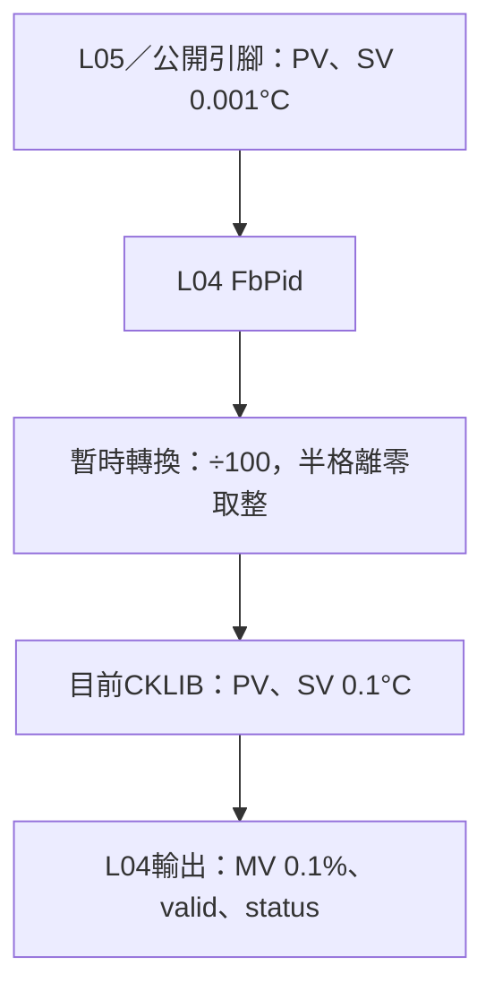

# FbPid 溫度單位相容邊界

## 摘要

2026-10-25：公開FbPidInput_t與L05 provider的PV／SV統一採int32、0.001°C。目前CKLIB仍使用0.1°C，暫時在FbPid.c的ToCklibTemperature單一邊界轉換，L05不得先除100。MV保持0.1%，時間與SetParameter設定值不因這次PV／SV引腳變更而自動改刻度。

**下一版待Colin將CKLIB的溫度介面統一為0.001°C；實際版本／能力確認後才移除相容轉換。** 此為待辦，不是目前後端已支援或可達0.001°C控制解析度的宣告。

## 目前轉換規則

PV／SV以最接近0.1°C取整，正好半格時離零；int64中間值避免INT32_MIN取負或加捨入量溢位。

| 公開原值 | 溫度 | CKLIB原值 |
|---|---|---|
| 25123 | 25.123°C | 251（25.1°C） |
| 25150 | 25.150°C | 252（25.2°C） |
| -25150 | -25.150°C | -252（-25.2°C） |
| 49／50 | 0.049／0.050°C | 0／1 |

ON_OFF／PID／PID_FB經控制器PV／SV設定使用同一轉換；AUTO_TUNE的SetSV／CollectAndSignal亦同。AT結束後交回控制器時，仍以公開原輸入經同一邊界轉一次，不重複除100。

## Colin下一版遷移清單

- [ ] Colin提供實際CKLIB新版與檔頭／參數單位規格，確認PV／SV為0.001°C。
- [ ] 核對PB／冷卻PB、Deadband、ON_OFF感度及AT相關溫度設定，不只改PV／SV。
- [ ] 移除ToCklibTemperature縮放，或依明確後端版本選擇相容模式；禁止只換.a而保留舊縮放。
- [ ] 同步修改PID、ON_OFF、PID_FB與AT mock期望值，驗證AT移交不重複換算。
- [ ] 更新產品參數轉換／文件並以實體庫及MCU確認。

舊呼叫端若曾以250表示25°C，現在必須傳25000；不得沿用舊值。正式PID provider尚未接入，Host測試已改用milli°C，並新增正負半格、INT32極值與AT移交驗證，ASan／UBSan通過。實體.a仍為空檔佔位，數值控制效果未驗證。
