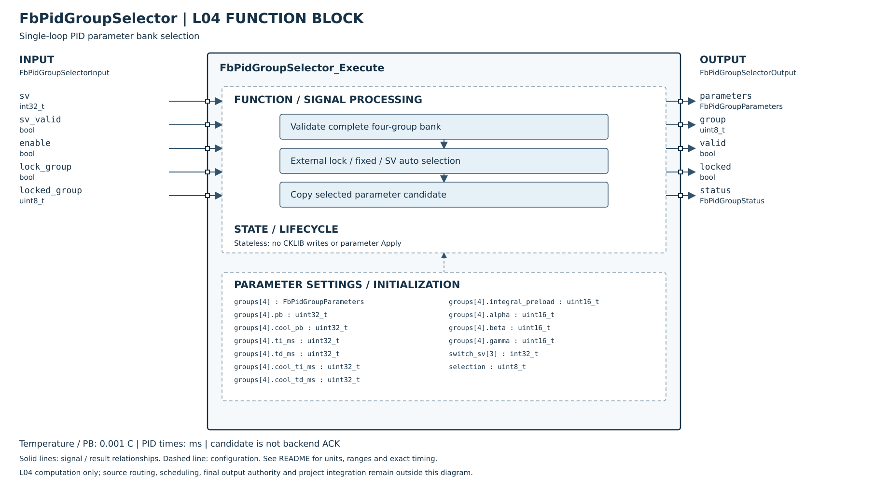

# FbPidGroupSelector

## 摘要

**完成狀態（2026-10-27 用語統一）：L04 實作完成；Host 單元測試通過。**

| 追蹤項目 | 狀態 |
|---|---|
| 產品串接 | 尚未完成；詳細待辦見本模組文件與產品整合文件 |
| MCU 實測 | 尚未實測 |

狀態用語見 [完成狀態與驗證定義](../../VERIFICATION_STATUS.md)；[測試報告](HOST_TEST.md)。本次為文件整理，不代表重新執行測試。

已完成單通道四組參數包裝、全組驗證、固定／依 SV 自動選組與外部指定鎖組，Host／ASan／UBSan 驗證通過。此 FB 無狀態、不引用 CKLIB、不配置動態記憶體。

輸出是完整候選參數副本，不是後端已套用的 ACK。L05 套用協調、CKLIB 刻度轉換、無擾切換、AT 結果讀回／保存、Register／NVM／MCU 仍未完成，不將本 FB 標為整個 PID 群組功能已完成。

## 參數與引腳

| 欄位 | 規格 |
|---|---|
| groups[4] | 每組獨立 PB、Ti、Td、冷卻側 PB／Ti／Td、IOF、Alpha／Beta／Gamma |
| pb／cool_pb | 1～3000000，溫度為 0.001°C；30°C 表示30000 |
| ti_ms／td_ms／cool_ti_ms／cool_td_ms | 0～30000000 ms；單位不隨 callback 或 Register 2052h 原始值改變 |
| integral_preload | 0～1000，0.1% |
| alpha／beta／gamma | 本專案參數模型為0～200，單位0.01；CKLIB 版本能力需另外驗證，不代表後端均接受 |
| switch_sv[3] | int32，溫度為0.001°C；非遞減，可相等 |
| selection | 0～3固定組別，4=Auto |
| input.sv／sv_valid | Auto使用的有效SV；固定組別或外部鎖組忽略SV品質，但仍驗證整個參數庫 |
| enable | false：輸出全部清零／invalid／DISABLED；重新啟用只依當次輸入計算 |
| lock_group／locked_group | true時使用外層提供的0～3組別，優先於固定／Auto；非法組別回 INVALID_INPUT |
| output.group／parameters | 候選組別及完整值副本，只在valid=true時可使用 |
| valid／locked／status | 成功、是否外部鎖組，以及OK／DISABLED／INVALID_ARGUMENT／INVALID_CONFIG／INVALID_INPUT |

Config 及輸入／輸出記憶體不可重疊，呼叫期間不可修改。NULL參數最優先判錯；有output時所有失敗均清零，不回傳前次參數。呼叫端可直接建立Config，也可用 DefaultConfig：四組 PB均30000、Ti120000ms、Td30000ms，冷卻側相同；IOF0、係數45／100／30，門檻皆1999900，固定第1組。無隱含Sensor配置或NVM讀取。

## 自動選組與驗證

SV<T2：group0；T2≤SV<T3：group1；T3≤SV<T4：group2；SV≥T4：group3。門檻相等會產生空區間，例如三個門檻均0時，SV<0為group0，SV≥0直接group3。沒有依PV切換、沒有遲滯或隱含歷史。

先驗證四組全部欄位與三門檻，再回傳任何候選值，避免未選組藏有無效值；這是純資料驗證，不涉及寫後端。ValidateConfig 可供外層 Pending／Apply 預先驗證。就算固定組別亦要求門檻及所有組別合法，讓整組配置始終可切換。

目前範圍採溫度控制的專案模型。若要支援其他類比工程量，其PB／SV合法範圍及倍率需經產品契約明訂，不能直接把V／mA值當milli°C。

## 與 L05／L04 PID 的串接界線

1. L05 維護配置與實際有效SV（SV1／SV2、dynaSV或串級副控SV須先定義），呼叫選組FB。
2. 候選值與「已套用組別」分開保存；候選未成功套用前不可更新實際組別Register。
3. 目前 FbPid PV／SV 仍0.1°C，Ti／Td檔頭仍標秒；PB精度、0.1秒等時間及係數範圍須在L04 CKLIB邊界驗證，不能直接以SetParameter傳本模型原值。
4. 實際套用應先完成後端能力檢查，再於計算邊界處理；現有逐項setter非交易式。部分失敗不得繼續用半套參數控制，回復／安全停用與STOP限制由後續協調流程完成。
5. 切組不自動 Reset 積分；也不宣稱保留狀態即無擾切換。需實體庫確認，通過前不得開放運轉中自動切組。

AT協調器應在開始時記住組別與參數快照，執行期間傳 lock_group=true 及相同 locked_group。此輸入只鎖組號，不鎖Config內容；AT期間禁止Apply修改該快照由外層負責。AT完成後須另讀回參數、驗證及寫回指定組別，本FB不讀寫CKLIB或NVM。

PID Group+1／+2／-1事件的Auto行為與邊界尚未定義，不在此FB偷偷採循環／飽和。各通道可持有各自Config，多個呼叫沒有共用可變狀態，不需要Init／Reset。

[Host 測試摘要與細則](HOST_TEST.md)。

## SVG FBD 維護說明

2026-10-26：方塊圖已依 [公開 Header](../FbPidGroupSelector.h) 核對。左側為輸入、右側為輸出，外框內為功能分組與參數設定；Init／Reset 的資源與初值另列，不代表新增執行引腳。標示 API result 的列是函式回傳值，非 Output 結構成員。內部箭頭表示功能關係，精確優先序與錯誤行為以程式及本文契約為準。圖面使用英文介面名稱，說明沿用本頁繁體中文文件。
