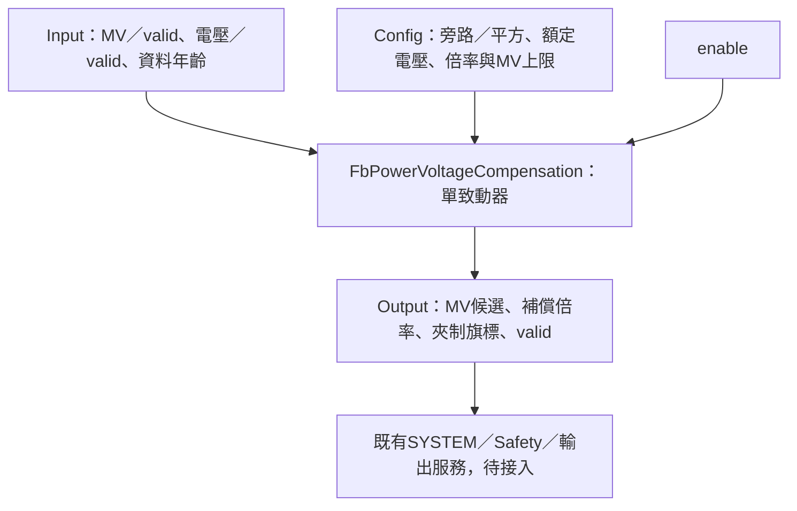

# FbPowerVoltageCompensation

## 摘要

已完成無狀態單致動器電壓補償及Host／ASan／UBSan驗證：BYPASS、電阻性負載V²補償、倍率／MV上限、最低電壓與資料品質。無heap，不需要Init／Reset，不操作硬體。產品輸出鏈、anti-windup、Register／NVM與MCU未接入。

模型假設阻值不變、輸入MV是線性功率比例，電壓是可代表全導通供電能力的RMS或DC值。不能將負載側已被PWM／SCR切割後的平均／RMS電壓直接套入，否則可能把自身Duty下降誤當供電壓降。相位控制命令若不等於線性功率比例，應先由產品定義正確換算。此FB不估算負載阻值或功率因數。

## 參數與引腳

| 欄位 | 定義 |
|---|---|
| mode | BYPASS或SQUARED；前者仍做MV有效性與上限檢查，不是關閉FB |
| nominal_mv／minimum_voltage_mv | 平方模式時皆須>0，單位mV；低於最低量測門檻回TOO_LOW，不以極大倍率補償 |
| maximum_age_ms | 電壓資料年齡上限，等號接受；0關閉此檢查 |
| minimum_gain_permille／maximum_gain_permille | 平方模式要求1≤min≤max≤10000；1000=1倍，10000=10倍 |
| maximum_mv | 0～1000，0.1%；不設非零下限，避免零需求被抬高 |
| input.mv／mv_valid | 單一路非負MV，0～1000；有號熱冷合成量不得直接輸入 |
| voltage_mv／voltage_valid／voltage_age_ms | 供電電壓與外層已計算的品質／年齡；BYPASS忽略這些欄位 |
| enable | false立即輸出0／invalid／DISABLED |
| output.mv | 補償且限制後的候選MV，不是硬體許可 |
| raw_gain／applied_gain | 原始平方倍率／夾制後倍率；旁路皆1 |
| requested_mv | 套倍率但尚未套maximum_mv的需求，double，供飽和診斷 |
| gain_limited／output_limited | 倍率／連續候選MV超設定範圍被限制 |
| at_limit | 最終整數MV等於上限；捨入後相等也可能true，不等同實體輸出飽和 |
| valid／bypassed／status | 有效性、是否旁路；OK／DISABLED／INVALID_ARGUMENT／INVALID_CONFIG／INVALID_INPUT／STALE／TOO_LOW |

DefaultConfig使用BYPASS、額定電壓0（尚未配置）、最低1000mV、age100ms、倍率0.25～4倍、MV上限1000。必須先配置合法額定電壓才能切SQUARED，避免擅自假設產品供電為230V。

## 運算契約

平方模式：gain_raw=(Vnominal/Vmeasured)²；gain夾在設定範圍；requested_mv=input.mv×gain；候選MV限制至maximum_mv後四捨五入，正好半格向上。倍率與上限為兩道獨立限制，不能以其中一個替代另一個。

例如額定230V、實測115V時倍率4；原MV10%得到40%，原MV40%則需求160%並受100%上限限制。實測460V時倍率0.25；這是模型演示，不代表允許實際設備跨此電壓工作。

double處理uint32電壓比值與平方，即使全範圍比值仍有限，倍率先限至10倍，轉int32前MV已限至1000。有效輸入MV0永遠得到0；但平方模式仍要求電壓品質有效，不因零需求就偽裝電壓正常。

驗證順序為必要NULL→enable→Config→MV品質／範圍→電壓品質／時效／最低值。錯誤輸出0且valid=false，不自動回退旁路或沿用上次MV。BYPASS只驗證共用設定maximum_mv，忽略電壓及補償倍率設定。

所有參數記憶體不可重疊，呼叫期間保持穩定；NULL不改任何實例，因本FB沒有實例狀態。參數變更立即影響下一次候選值，沒有濾波／斜率或無擾切換保證。

## 外層待辦

L05須定義FF加總、電壓補償、輸出折線／限幅的次序，及熱冷雙輸出各自適用的供電來源。兩路MV不能未經定義就共用單一補償。當候選被限制，PID追蹤／anti-windup尚需正式後端回授流程，旗標存在不代表已完成。

量測失效時最終使用0、停機或其他既有安全策略，由SYSTEM／Safety／輸出服務決定，本FB無權重定義。Register／NVM及MCU建置、浮點成本與實際量測驗證仍待完成。[Host細則](HOST_TEST.md)。
