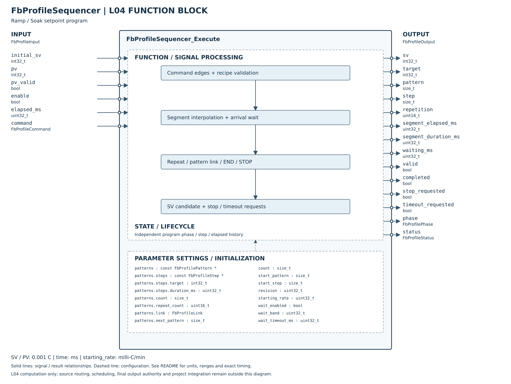

# FbProfileSequencer

## 摘要

**完成狀態（2026-10-27 用語統一）：L04 實作完成；Host 單元測試通過。**

| 追蹤項目 | 狀態 |
|---|---|
| 產品串接 | 尚未完成；詳細待辦見本模組文件與產品整合文件 |
| MCU 實測 | 尚未實測 |

狀態用語見 [完成狀態與驗證定義](../../VERIFICATION_STATUS.md)；[測試報告](HOST_TEST.md)。本次為文件整理，不代表重新執行測試。

已實作 L04 程序執行核心及 Host／ASan／UBSan 測試：時間式 Ramp／Soak、起始樣式／步驟、可選起始斜率、額外重複、樣式連接、END／STOP、Start／Hold／Resume／Advance／Reset、段末到溫等待與逾時。此為本專案明確契約，不宣稱完全相容 DTDM04 特殊首步／零時間規則。

一個狀態實例代表一條程序，程序表可唯讀共享。不操作 PID、Register、NVM、通訊或實體輸出。L05／產品流程、斷電持久化恢復與 MCU 驗證尚未完成。

## Config 參數

| 參數 | 定義 |
|---|---|
| patterns／count | 借用唯讀 Pattern 陣列，1～16樣式；非固定四樣式產品配置 |
| pattern.steps／count | 每樣式1～64個Step；每段target為int32、duration_ms為uint32 |
| repeat_count | 額外重複次數0～65535，0代表一次；每次重複由該樣式step0開始 |
| link／next_pattern | LINK銜接有效樣式、END保持最後SV並completed、STOP保持診斷SV並發停止請求 |
| start_pattern／start_step | 啟動位置；從中間步開始時，第一輪跑至末步，額外重複仍從step0開始 |
| revision | 任何配方內容／身分變更皆更新；啟動後連同表格儲存體保持不變，直到Reset／disable |
| starting_rate | 0.001°C/min；只用於本次Start的第一個步驟且其duration=0時；0不啟用 |
| wait_enabled／wait_band | 段末等待有效PV滿足abs(PV-target)≤band，band為uint32同尺度溫差 |
| wait_timeout_ms | 等待逾時，0明確表示無限等待；只在wait_enabled時使用 |

Config無隱含配方預設；以零初始化後填入合法表格。ValidateConfig檢查表格指標、容量、起始位置及link。表格大小／生命週期及記憶體可讀性由呼叫端保證；頂層與陣列不得在執行期間變動。

## Input／Output 引腳

| 引腳 | 契約 |
|---|---|
| initial_sv | START時採樣為首段起點，可由外層明確提供PV、前次SV或固定值；其他時候忽略 |
| pv／pv_valid | 段末等待才消費；無效時FAULT，不把舊PV當有效到溫。一般Ramp／Soak不檢查PV，既有Sensor Safety獨立運行 |
| elapsed_ms | 實際執行間隔，uint32；hold不累計，不追補hold期間時間 |
| enable | false清除所有歷史，輸出0／invalid／DISABLED；再啟用需要START |
| command | NONE／START／STOP／HOLD／RESUME／ADVANCE／RESET，命令值改變形成一次edge；重複同命令須先回NONE |
| sv／target | 動態SV與當前目標；溫度採0.001°C，不跟UI秒／分或顯示刻度變動 |
| pattern／step／repetition | 0起始索引與目前額外重複次序 |
| segment_elapsed_ms／segment_duration_ms／waiting_ms | 段時間與等待時間；等待累計飽和UINT32_MAX |
| valid／phase／status | valid是SV數值有效性，不是輸出許可；IDLE無效，RUNNING／WAITING／HELD／COMPLETED／STOPPED有已啟動SV時有效，FAULT無效 |
| completed | END之後的穩定狀態旗標，非一次動作脈衝 |
| stop_requested／timeout_requested | 停止／逾時的一次呼叫脈衝；FAULT狀態持續，但不每週期重送 |

實例先零初始化或Init；必要參數NULL時回INVALID_ARGUMENT，不更動實例，有output時清零。所有參數記憶體不得重疊。沒有動態配置或可變全域狀態。

## Ramp／Soak 與零時間

首段從initial_sv開始，其餘段從前一段最終SV開始；在duration_ms內線性移至target。target相同即Soak，從段開始計時，不是PV到溫後再重新計完整Soak時間。整數插值的位移朝段起點截取，端點精確到target；以uint64乘法容納完整int32差值乘uint32時間，避免signed overflow。

START那次只建立狀態，忽略之前的elapsed；duration=0且無起始斜率時，在下一次正常執行立即跳到target並處理銜接。起始斜率有效時，用ceil(abs(target-initial_sv)×60000/rate)產生首段時間；超過UINT32_MAX拒絕並FAULT。起始斜率不套到之後循環／連接的零時間段。

一般執行的剩餘時間可跨段、重複與樣式，並處理零時間段。單次最多64次銜接；超出回TRANSITION_OVERFLOW／FAULT並提出停止請求，而不是阻塞或無聲丟棄時間。大型dt即使配方合法也可能觸及此限制，外層排程不得任意合併超長時間。

## 等待與命令優先序

每段結束後，wait_enabled才檢查到溫。首次進入等待的同次呼叫，可將段結束後剩餘dt計為等待時間；若先前已WAITING，這次觀察到PV入帶，銜接下一段但不將先前等待間隔回算為下一段時間。只知道本次PV，不推斷兩次樣本之間何時到溫；跨多段的到溫判斷皆使用本次Snapshot，此限制由L05取樣與排程契約管理。

等待時超過或等於非零timeout為WAIT_TIMEOUT，停止請求／逾時請求各一次；無效PV為INVALID_INPUT／FAULT。後續必須RESET或disable才能恢復，不接受START自動清故障。

1. NULL檢查最先；enable=false優先清除。
2. RESET命令可在配置錯誤或FAULT時清除，當次IDLE且不計時間。
3. FAULT鎖定；配置變更／不合法命令亦FAULT。
4. STOP當次停止並送請求；不是直接關硬體。
5. START只在IDLE／COMPLETED／STOPPED接受，運行中START不重啟。
6. HOLD保存RUNNING或WAITING階段；RESUME回原階段，兩者該次都不計dt。
7. ADVANCE只在RUNNING／WAITING接受：SV立即移到本段target並跳下一段，略過本段剩餘時間／到溫等待；HELD不接受跳步。

HOLD／RESUME／ADVANCE的命令週期不追補dt，避免不明確回算命令抵達時刻。STOPPED／COMPLETED保留最後SV，但實體輸出受SYSTEM控制。命令脈衝需要外層可靠佇列，不能將completed或phase每週期當新命令發送。

## 尚未完成

配方屬於哪個產品通道、Pending／Apply、步驟索引Register轉count、動態SV接PID／Cascade、SYSTEM命令受理、NVM持久化與斷電接續版本格式、MCU驗證仍待接入。不可把記憶體中的狀態struct直接當可跨版本保存的FRAM格式，也不可把程序恢復視為Safety允許恢復加熱。

[Host測試細則](HOST_TEST.md)。

## SVG FBD 維護說明

2026-10-26：方塊圖已依 [公開 Header](../FbProfileSequencer.h) 核對。左側為輸入、右側為輸出，外框內為功能分組與參數設定；Init／Reset 的資源與初值另列，不代表新增執行引腳。標示 API result 的列是函式回傳值，非 Output 結構成員。內部箭頭表示功能關係，精確優先序與錯誤行為以程式及本文契約為準。圖面使用英文介面名稱，說明沿用本頁繁體中文文件。
