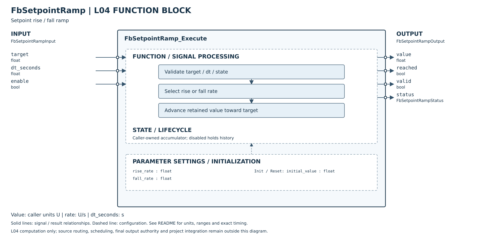

# FbSetpointRamp Host Unit Test

## 介面與規則

- Config：rise_rate、fall_rate 為有限非負 float；零速率表示保持，不代表無限制。U 由呼叫端定義，不假設特定溫度或產品單位。
- Input：target 為有限 float；dt_seconds 為有限非負秒數，零（含負零）不前進。每次呼叫使用當次目標／速率；可隨週期改變。
- State：每個實例獨立的 value、double precise_value 和 initialized；第一次使用前零初始化，然後 Init(state, initial_value)。
- Init/Reset：明確指定有限初值；立即設定狀態，不執行同週期斜率；下次 Execute 才前進。失敗不修改狀態。
- Output：成功 valid=true，即使本週期沒有位移；reached 表示內部 precise_value 已達目標；float 輸出可能因量化提前顯示相同值。status 與函式回傳值一致。
- 優先順序：指標檢查 → 已初始化且有限狀態 → enable → config → target/dt → 計算。停用忽略數值設定／輸入，保持狀態；valid=false、reached=false、DISABLED。
- 錯誤不更新狀態；可寫 Output 顯示已初始化且有限的儲存 value，否則零；僅作診斷，無效輸出不可作控制值；valid/reached=false。NULL Output 不寫入。各參數須指向正確型別且互不重疊的儲存。
- float 介面、double 中間運算避免 float32 極值差／rate×dt 溢位；依移動方向使用獨立速率，並以目標截斷避免超越。不設定任意最大 dt，極大有限 dt 可直接到達目標。
- 浮點限制：double precise_value 保留小於 float ULP 的增量；方向判斷及斜率限制依內部值計算。float 輸出會量化，個別輸出跳動可比 rate×dt 多最多一個 ULP；極小到低於 double 精度的增量仍可能被捨去。State 只能由 API 更新，內部值非有限、超出 float 範圍或與 value 不一致則拒絕。

## 摘要

- 2026-10-16，GCC 14.2.0，Linux x86_64，44 個編號案例全部 PASS（UT-17/18/23 各含多個輸入）。
- C99 -O0 -Wall -Wextra -Werror -pedantic（不連結 libm）：通過；ASan + UBSan：通過，無診斷。C++11 Header 加 C object 連結煙霧測試通過。
- LeakSanitizer 預設執行因環境 ptrace 不支援而失敗，改以 detect_leaks=0；不宣稱漏記憶體偵測通過。本 FB 無動態配置。
- CMake/CTest 未執行：環境無 cmake；已新增建置／測試項目，以下以直接編譯驗證。
- 測試來源：[test_fb_setpoint_ramp.c](../../../../../Tests/Unit/L04_FunctionBlock/test_fb_setpoint_ramp.c)。

## 測試細則

| ID | 項目 | 設定／輸入 | 預期且實測結果 | 結果 |
|---|---|---|---|---|
| UT-01 | 初始化 | initial=0 | initialized=true,value=0 | PASS |
| UT-02 | 上升 | target=10,rise=2,dt=1 | value=2,未到達 | PASS |
| UT-03 | 上升不超越 | dt=10 | value=10,reached=true | PASS |
| UT-04 | 下降獨立速率 | target=-10,fall=4,dt=1 | value=6 | PASS |
| UT-05 | 下降到達 | dt=4 | value=-10 | PASS |
| UT-06 | 零時間 | dt=0 | 保持-10 | PASS |
| UT-07 | 零上升率 | rise=0 | 保持-10 | PASS |
| UT-08 | 零下降率 | fall=0,target=-20 | 保持-10 | PASS |
| UT-09 | 已到目標 | target=-10,rate=0 | reached=true | PASS |
| UT-10 | 停用 | enable=false,數值欄位非法 | DISABLED,保持狀態,valid=false | PASS |
| UT-11 | NaN 上升率 | rise=NaN | INVALID_CONFIGURATION | PASS |
| UT-12 | 負上升率 | rise=-1 | INVALID_CONFIGURATION | PASS |
| UT-13 | 無限上升率 | rise=Infinity | INVALID_CONFIGURATION | PASS |
| UT-14 | 負下降率 | fall=-1 | INVALID_CONFIGURATION | PASS |
| UT-15 | NaN 下降率 | fall=NaN | INVALID_CONFIGURATION | PASS |
| UT-16 | 無限下降率 | fall=Infinity | INVALID_CONFIGURATION | PASS |
| UT-17 | 非法目標三種 | NaN,+Infinity,-Infinity | INVALID_INPUT,狀態保持 | PASS |
| UT-18 | 非法時間四種 | -1,NaN,+Infinity,-Infinity | INVALID_INPUT,狀態保持 | PASS |
| UT-19 | 錯誤後恢復與小數時間 | rise=2,dt=0.5 | -10變-9,valid=true | PASS |
| UT-20 | 重設 | initial=3 | 立即設3,不執行斜率 | PASS |
| UT-21 | 無效重設 | initial=NaN | INVALID_INPUT,保持3 | PASS |
| UT-22 | 無效初始化 | initial=Infinity | INVALID_INPUT,保持3 | PASS |
| UT-23 | Init/Reset空指標 | state=NULL | INVALID_ARGUMENT | PASS |
| UT-24 | 空Config | config=NULL | INVALID_ARGUMENT,保持3 | PASS |
| UT-25 | 空Input | input=NULL | INVALID_ARGUMENT,保持3 | PASS |
| UT-26 | 空State | state=NULL | INVALID_ARGUMENT,output.value=0 | PASS |
| UT-27 | 空Output | output=NULL | INVALID_ARGUMENT,保持3 | PASS |
| UT-28 | 未初始化 | zero-initialized state | INVALID_STATE | PASS |
| UT-29 | 損壞狀態 | state.value=NaN | INVALID_STATE,output.value=0 | PASS |
| UT-30 | 極端反號範圍 | -FLT_MAX到+FLT_MAX,rate=FLT_MAX,dt=1 | value=0,未到達 | PASS |
| UT-31 | 極大時間 | dt=FLT_MAX | 到達+FLT_MAX,有限輸出 | PASS |
| UT-32 | 極端下降 | +FLT_MAX到-FLT_MAX,rate=FLT_MAX,dt=2 | 到達-FLT_MAX | PASS |
| UT-33 | 實例隔離A | A=0,B=20,執行A | A=2,B=20 | PASS |
| UT-34 | 實例隔離B | 執行B,fall=1,dt=1 | B=19,A=2 | PASS |
| UT-35 | 負零時間 | dt=-0.0 | 保持2 | PASS |

| UT-36 | 小量長期累積 | 32000→32001,rate=.001,dt=.01,100000週期 | 輸出>32000.99且不超過32001 | PASS |
| UT-37 | 累積後反向 | target=31999,fall=.002,50000週期 | 輸出約32000，雙精度方向判斷 | PASS |
| UT-38 | 重設小數歷史 | Reset(7) | value=precise_value=7 | PASS |
| UT-39 | 狀態不一致 | value=7,precise_value=8 | INVALID_STATE，狀態保持 | PASS |

| UT-40 | 小數歷史停用 | enable=false | precise_value不變 | PASS |
| UT-41 | 小數歷史零時間 | dt=0 | precise_value不變 | PASS |
| UT-42 | 小數歷史零速率 | rise=0 | precise_value不變 | PASS |
| UT-43 | 內部值越界 | precise_value=2×FLT_MAX | INVALID_STATE，不進行越界float轉型 | PASS |
| UT-44 | 內部值非有限 | precise_value=NaN | INVALID_STATE | PASS |

## 記憶體與重設

無 heap、外部 buffer 或靜態可變共享狀態；時間與空間均 O(1)。本次 Host sizeof：Config=8、Input=12、State=24、Output=12 bytes；目標 ABI padding 可能不同，請以目標 sizeof 為準。Reset 清除原 value 與 precise_value 的累積小數歷史 並以新初值重新開始，不修改 Config/Input/先前 Output；Output 只在下次 Execute 更新。

## 重現方式

在 platform repository 根目錄執行（輸出放 /tmp）：

```sh
cc -O0 -std=c99 -Wall -Wextra -Werror -pedantic \
 -I L04_FunctionBlock/Control L04_FunctionBlock/Control/FbSetpointRamp.c \
 Tests/Unit/L04_FunctionBlock/test_fb_setpoint_ramp.c -o /tmp/test_fb_setpoint_ramp
/tmp/test_fb_setpoint_ramp
cc -O0 -std=c99 -Wall -Wextra -Werror -pedantic \
 -fsanitize=address,undefined -fno-omit-frame-pointer -g \
 -I L04_FunctionBlock/Control L04_FunctionBlock/Control/FbSetpointRamp.c \
 Tests/Unit/L04_FunctionBlock/test_fb_setpoint_ramp.c -o /tmp/test_fb_setpoint_ramp_san
ASAN_OPTIONS=detect_leaks=0 /tmp/test_fb_setpoint_ramp_san
```

Host 驗證不等於 MCU 編譯、實機週期時間、控制迴路調校或硬體安全認證；未接入 L03/L05、Register Map、NVM 或硬體。
