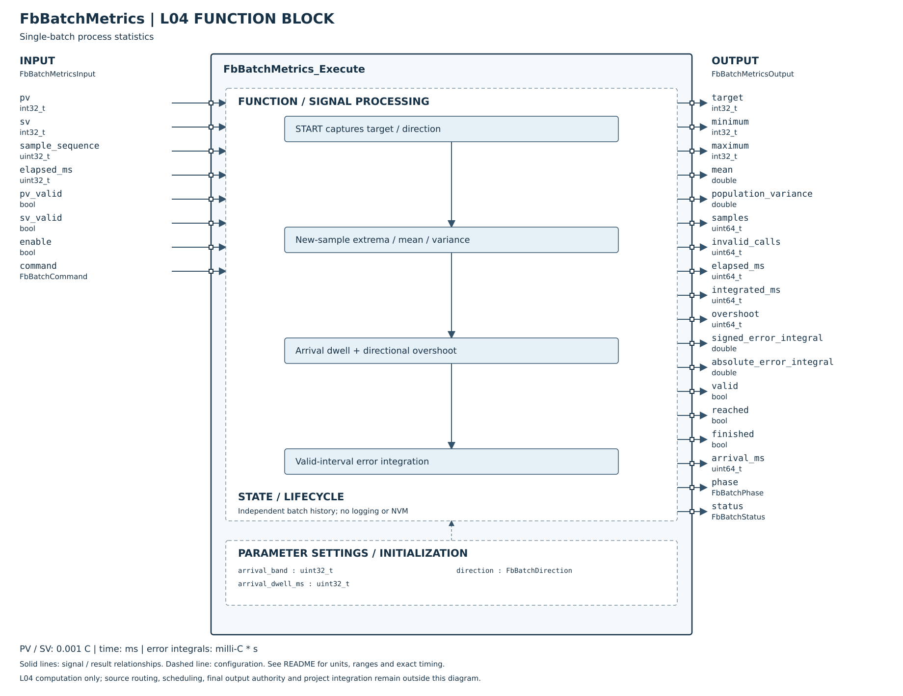

# FbBatchMetrics

## 摘要

已完成 L04 批次統計核心與Host／ASan／UBSan驗證：PV極值／樣本平均／母體變異數、方向性過衝、到溫與連續帶內時間、有效區間偏差積分、批次開始／結束及Reset。此為專案統計需求，不列為DTDM04對等功能缺口。

單實例代表一個批次，無heap、Register、NVM或硬體依賴。L05資料來源、批次命令串接、保存／UI及MCU尚待接入。統計不決定是否停止加熱。

## Config／Input 引腳

| 引腳 | 定義 |
|---|---|
| arrival_band | uint32，abs(PV−鎖定SV)≤band視為帶內，含等號 |
| arrival_dwell_ms | 連續有效帶內時間；0表示首筆帶內即到達 |
| direction | HEATING或COOLING，決定過衝方向；非法值拒絕 |
| pv／pv_valid | int32溫度0.001°C；品質由外層處理過期、錯誤碼及來源 |
| sv／sv_valid | START時鎖定有效目標；批次內變化不改統計基準；多段程序若要逐段統計由外層另開批次 |
| sample_sequence | uint32新樣本識別；與上次有效樣本不同才計平均／極值；UINT_MAX→0亦視為新樣本 |
| elapsed_ms | uint32實際執行間隔；START／STOP／RESET命令週期不追補dt |
| enable | false立即清除所有統計並回0／invalid／DISABLED；重新啟用需START |
| command | NONE／START／STOP／RESET，命令改變為一次edge，重複同命令須回NONE |

實例先Init或零初始化。Config無隱含到溫帶預設；零初始化Config為升溫、band0、dwell0。參數／輸入／狀態／輸出不可重疊，呼叫期間不得改動。

## Output 與計算契約

| 結果 | 定義 |
|---|---|
| target | START鎖定SV |
| samples／minimum／maximum／mean | 有效新樣本數、極值及等權平均；不是時間加權平均 |
| population_variance | Welford母體變異數M2/N；一筆時0，無sqrt需求 |
| overshoot | 升溫max(PV−SV,0)，降溫max(SV−PV,0)，整批最大；uint64容納完整int32差 |
| elapsed_ms | 量測批次累計時間，含無效資料期間 |
| integrated_ms | 前後端皆有效的積分時間，不含缺失／恢復首區間 |
| invalid_calls | pv_valid=false的執行次數，不等於失效樣本數或失效時間 |
| signed_error_integral | ∫(PV−鎖定SV)dt，左矩形以前一有效PV代表區間；單位milli°C·秒 |
| absolute_error_integral | ∫abs(PV−鎖定SV)dt，同上；不把正負偏差抵消 |
| reached／arrival_ms | 首次滿足有效連續帶內時間時鎖定；arrival為本次觀察時刻，不倒推實際跨越時刻 |
| phase／finished | IDLE／RUNNING／COMPLETED／FAULT；STOP使finished保持true，不是每次新完成事件 |
| valid／status | valid表示已有歷史統計可讀且非FAULT，不表示本次PV有效；status會回INVALID_INPUT指出本次缺資料 |

mean採double逐筆更新；時間與筆數uint64，超出計數範圍FAULT，不無聲回繞。double統計在極大筆數仍有浮點精度限制，不宣稱任意長度逐位精確。溫度轉°C時mean／過衝除1000、variance除1000000、偏差積分除1000得到°C·秒。

重複sequence不增加樣本筆數，但只要外層仍標pv_valid=true，可用該保持值覆蓋積分與到溫時間。呼叫端必須保證相同sequence值一致、並於過期時改為invalid，不能用舊樣本無限假裝連續量測。若平台無法保證區間品質，應在L05更保守地標invalid。

無效PV仍累計批次時間，跳過樣本、積分並清除到溫連續時間；恢復首筆也不跨越缺資料區間積分。到溫已達成旗標保留；它代表曾達標，不代表目前仍在帶內。STOP後不再計數，歷史結果可讀；RUNNING時START不重啟，需STOP再新START或RESET。

START遇sv_valid=false拒絕並保留既有結果，持續高命令不自動重試，需新edge。批次中修改Config、非法命令或計數溢位進FAULT，須RESET或disable清除。RESET可清FAULT，且優先於Config驗證；必要NULL最先回INVALID_ARGUMENT，不改實例，有output則清零。

不提供資料保存／斷電接續、窗口統計或步驟自動分批。L05可把程序開始／結束對接命令，但必須明確定義統計對象與時間邊界，不直接將Ramp／Soak多變SV當固定目標批次。

[Host驗證細則](HOST_TEST.md)。

## SVG FBD 維護說明

2026-10-26：方塊圖已依 [公開 Header](../FbBatchMetrics.h) 核對。左側為輸入、右側為輸出，外框內為功能分組與參數設定；Init／Reset 的資源與初值另列，不代表新增執行引腳。標示 API result 的列是函式回傳值，非 Output 結構成員。內部箭頭表示功能關係，精確優先序與錯誤行為以程式及本文契約為準。圖面使用英文介面名稱，說明沿用本頁繁體中文文件。
