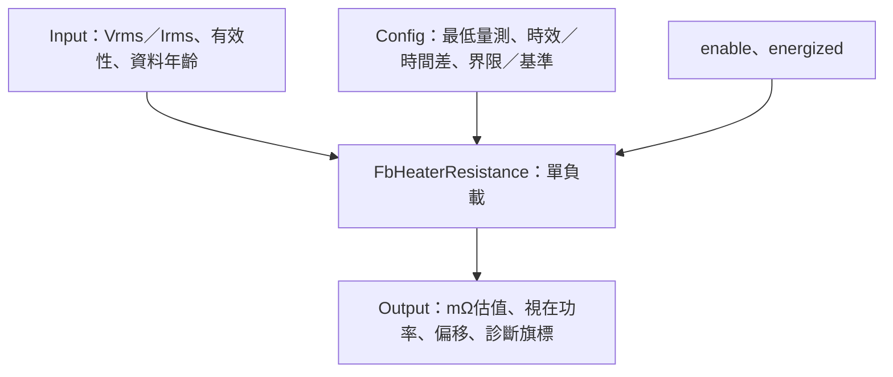

# FbHeaterResistance

## 摘要

已完成 L04 單負載電阻比值估算與Host／ASan／UBSan驗證，包含品質／時間檢查、最低電壓／電流、界限及基準偏移。無狀態、無動態配置、不操作輸出，無需Init／Reset。L05量測來源／時間窗、SYSTEM處置、Register／NVM與MCU尚未整合。

對電阻性負載，可用Vrms／Irms估算R；一般交流負載的比值是阻抗幅值，不能自動宣稱為純電阻。Vrms×Irms是視在功率，不保證是實功率或熱功率。本FB不從ADC波形計算RMS，不提供功率因數或接線補償。

## 引腳與參數

| 欄位 | 定義 |
|---|---|
| input.voltage_mv／current_ma | uint32，時間對齊的RMS或DC幅值；不能將瞬時值與RMS混用 |
| voltage_valid／current_valid | 量測品質，需先排除ADC／來源異常 |
| voltage_age_ms／current_age_ms | 外層以相同now算出的資料年齡；差值用於時間對齊檢查 |
| enable | false當次零／invalid／DISABLED |
| energized | 來源／負載正處於適合估算的供電狀態；false回INACTIVE，不拿關閉期間的0A判斷斷線 |
| minimum_voltage_mv／minimum_current_ma | 皆必須>0，含等號可算；低於門檻回LOW_VOLTAGE／LOW_CURRENT |
| maximum_age_ms | 超過此年齡為STALE，0只關閉年齡上限，不關閉時間差檢查 |
| maximum_skew_ms | 兩來源年齡差大於設定為UNALIGNED，等號接受 |
| limits_enabled／low_mohm／high_mohm | 可選診斷界限，0≤low≤high≤MAX；等號不報超界 |
| reference_enabled／reference_mohm | 可選有效基準，啟用需1～MAX；不與未知0Ω基準相除 |
| output.resistance_mohm | uint64 mΩ；除1000為Ω |
| output.apparent_power_mva | uint64 mVA；除1000為VA，不直接命名mW |
| reference_change_permille／reference_valid | 有號相對基準偏移，單位千分之一；+150代表+15% |
| valid／below_limit／above_limit | valid為比值可估算；界限旗標只供診斷，不使估值自動失效 |
| status | OK／DISABLED／INACTIVE／INVALID_ARGUMENT／INVALID_CONFIG／INVALID_INPUT／STALE／UNALIGNED／LOW_VOLTAGE／LOW_CURRENT |

DefaultConfig：最低100mV／10mA、最大年齡100ms、最大時間差10ms，界限／基準關閉。這些只是可用初始化資料，實際值應依RMS更新時間、ADC解析度及負載決定，不能視為所有平台固定規格。

## 計算與邊界

- R_mΩ=round(V_mV×1000/I_mA)。例如230000mV／10000mA得23000mΩ。
- S_mVA=round(V_mV×I_mA/1000)。上述例子得2300000mVA，即2300VA。
- 基準偏移=round((R−Rref)×1000/Rref)。正負分開計算絕對量，正好半格時離零取整。
- 非負比值正好半格向上取整；整數乘法使用uint64，最大阻值設定／基準為4294967295000mΩ，涵蓋最大mV與1mA的可表示比值。

公式先驗證最低電流，禁止除0。uint32乘積及捨入加數皆在uint64內；基準差／倍率亦受MAX界限保證不溢位。極端小比值可量化成0mΩ，表示低於此輸出解析度，不能單靠此值宣稱真短路。

錯誤輸出全部清零／invalid且不保留舊估值。驗證順序：必要NULL→enable→energized→Config→來源valid→年齡→時間差→最低電壓→最低電流；若電壓電流均低，先回LOW_VOLTAGE。所有記憶體參數不可重疊，呼叫期間保持穩定。

## 品質與整合限制

相同timestamp並不保證RMS量測窗相同，兩來源須有相容的窗長／濾波／量測點，外層負責。PWM／SCR週期、分段供電與負載升溫皆會改變可用量測條件與阻值；energized不能只因控制命令MV>0就無條件宣告，而應由產品量測契約決定。

LOW_CURRENT只代表不足以穩定估算，不能直接判定加熱器開路；上下限亦可能受溫度係數、配線或校正影響。若需故障成立延遲、鎖存或保護動作，另用Alarm／SYSTEM／Safety處理，不把診斷FB變成第二套輸出控制。

本FB不提供RMS擷取、斷電保存、校正或濾波歷史；可由外層串接獨立濾波／記錄，但要保留各自單位與有效性。[Host細則](HOST_TEST.md)。
