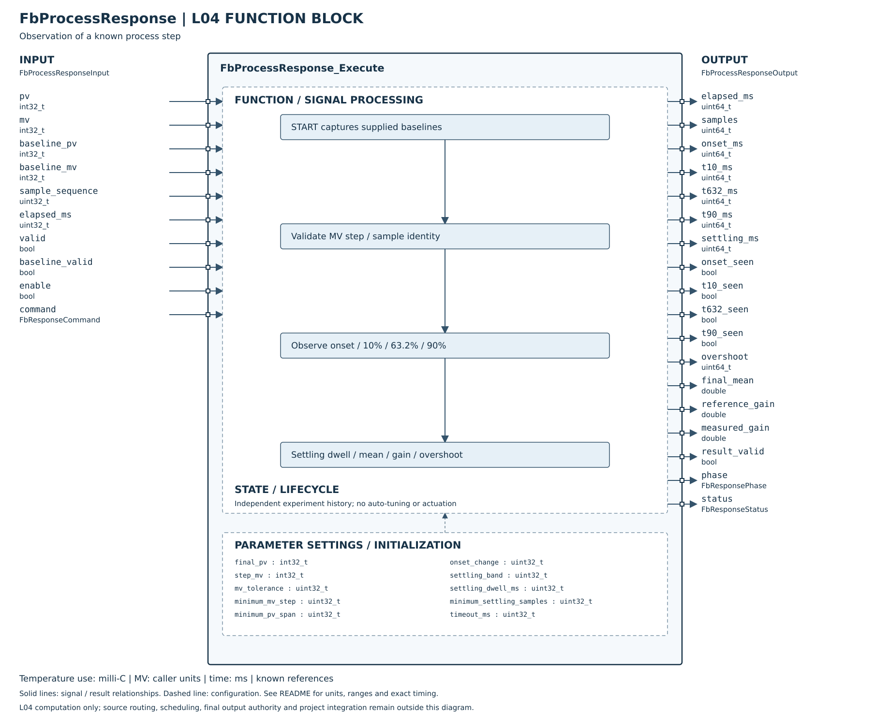

# FbProcessResponse

## 摘要

已完成已知基準的步階響應觀測核心與Host／ASan／UBSan驗證：響應起始、10%／63.2%／90%觀測時間、方向過衝、終值帶內穩定確認與增益。PV／MV失效、步階條件改變、逾時會使觀測失效，不補猜資料。

這不是未知製程自動辨識、模型擬合或PID自整定。預期終值與步階前基準由外層提供；t63.2不是自動宣稱的一階時間常數，onset也不是已辨識的純死時間。FB不改MV、不啟動測試加熱、不寫PID參數。L05量測實驗協調、UI／保存與MCU仍未接入。

## Config參數

| 參數 | 定義 |
|---|---|
| final_pv／step_mv | 已知預期終值、名義步階後MV；PV溫度為0.001°C、MV可採0.1% |
| mv_tolerance | abs(當前MV−step_mv)容許範圍，含等號 |
| minimum_mv_step | abs(step_mv−baseline_mv)最低要求，必須>0 |
| minimum_pv_span | abs(final_pv−baseline_pv)最低要求，必須>0 |
| onset_change | 沿響應方向的起始變化門檻，必須>0且≤已知PV幅度 |
| settling_band | abs(PV−final_pv)≤band為終值帶，必須嚴格小於已知PV幅度的10%，避免基準值也被當終值 |
| settling_dwell_ms | 帶內持續觀測時間，可0；不得大於timeout |
| minimum_settling_samples | 至少2筆不同序號的有效帶內樣本 |
| timeout_ms | 必須>0，限制整次觀測時間 |

ValidateConfig只檢查不依賴基準的條件；START時再驗證幅度、onset與band。無隱含實驗預設值，產品應明確配置。觀測期間修改Config會FAULT；完成／取消後可用新Config開始新觀測。

## 引腳與生命週期

| Input | 定義 |
|---|---|
| pv／mv、valid | 外層已確認品質／時間對齊的實際值；不是未驗證的控制命令副本 |
| baseline_pv／baseline_mv、baseline_valid | START時採樣的步階前穩定基準；外層負責基準確實穩定，本FB不回看歷史或自動判定 |
| sample_sequence | 新PV樣本識別，變更才判斷門檻、計數與更新穩定均值；同序號需代表同筆樣本 |
| elapsed_ms | 實際時間間隔；START／STOP／RESET命令週期不回算先前dt |
| command | NONE／START／STOP／RESET，值改變形成edge；同命令重複需先回NONE |
| enable | false清除全部狀態與結果，回DISABLED；重新啟用需要START |

Init或零初始化實例，無heap或全域可變狀態。NULL必要參數回INVALID_ARGUMENT，有output時清零、不改實例。所有記憶體不可重疊且呼叫期間穩定。

START只在非OBSERVING且非FAULT時接受。運行中START不重開；STOP取消並保留部分診斷，但result_valid=false。RESET可清FAULT並優先於配置驗證。失效／實驗條件偏離／逾時鎖FAULT，不能用持續START自動重試。

## 指標定義與精度

以`span=abs(final_pv−baseline_pv)`、方向為final_pv−baseline_pv的正負，`progress`是PV沿該方向離開baseline的距離：

- onset：首次progress≥onset_change。
- t10／t632／t90：首次progress分別達到span的10%／63.2%／90%。採整數比例比較，不以浮點誤差改變門檻。
- overshoot：沿方向超過已知final_pv的最大量，uint64容納完整int32範圍。
- settling_ms：滿足連續新樣本都在band，且持續時間及筆數都達標的**確認時刻**，不是回填首次入帶時刻；出帶重新計時／計數。
- final_mean：最後這段已確認帶內新樣本的等權均值。
- reference_gain=(final_pv−baseline_pv)/(step_mv−baseline_mv)。
- measured_gain=(final_mean−baseline_pv)/(step_mv−baseline_mv)，只在完成時發布有效結果。

增益以名義步階差為分母，不自動平均實際MV或扣除負載變化；MV容許帶較大時這是已知估計限制。若PV用milli°C、MV用0.1%，將數值除100可得°C/%。不額外輸出臆測可信度百分比。

所有時間從START算起，以本次新樣本到達呼叫的時刻確認，不內插過去跨越點。先前看過的重複序號不會製造更多穩定樣本；其仍可讓elapsed前進，故最終可能逾時。外層必須保證資料新鮮度及取樣時間誤差，不能拿舊PV來證明連續穩定。

## Output與失效

Output有各門檻seen旗標及時間，0ms也可是真實觀測，不能只用時間0代表未達；samples為新有效樣本數。result_valid只在COMPLETED時true，OBSERVING／CANCELLED／FAULT都false，部分門檻仍可供診斷。IDLE為尚未啟動。

新樣本在exact timeout時先判定能否完成，成功則接受；已超過timeout的樣本不再更新指標。到timeout仍未穩定即FAULT。樣本計數溢位亦FAULT；elapsed在活動時受uint32 timeout限制，每次加uint32 dt以uint64處理。

valid=false或MV偏離容許帶會中止整次觀測，不跨缺失區間延伸響應時間。完成後結果凍結，不再代表後續過衝或長期穩定；要持續監控需另用Alarm／BatchMetrics。輸出不包含任何停止硬體命令，SYSTEM／Safety維持既有權責。

[Host測試細則](HOST_TEST.md)。

## SVG FBD 維護說明

2026-10-26：方塊圖已依 [公開 Header](../FbProcessResponse.h) 核對。左側為輸入、右側為輸出，外框內為功能分組與參數設定；Init／Reset 的資源與初值另列，不代表新增執行引腳。標示 API result 的列是函式回傳值，非 Output 結構成員。內部箭頭表示功能關係，精確優先序與錯誤行為以程式及本文契約為準。圖面使用英文介面名稱，說明沿用本頁繁體中文文件。
