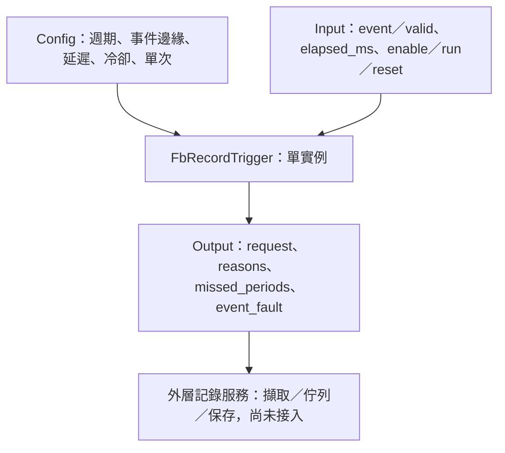

# FbRecordTrigger

## 摘要

已完成 L04 週期／事件記錄觸發、事件延遲／冷卻／單次武裝與Host／ASan／UBSan驗證。這是純觸發判斷，不是SYSTEM EventService，也不包含資料擷取、環形緩衝、前後觸發波形、檔案或NVM。

不依賴硬體或動態配置；一實例代表一組記錄觸發設定，可供不同產品使用。L05與記錄服務、資料品質、保存及MCU尚待接入。

## 參數與引腳

| 類別 | 欄位 | 定義 |
|---|---|---|
| Config | periodic_enabled／period_ms | 週期來源開關；啟用時period>0，uint32毫秒 |
| Config | event_enabled／edge | 事件來源開關；RISING／FALLING／BOTH |
| Config | event_delay_ms | 接受事件邊緣後等待時間，0立即請求；不是位準防彈跳條件 |
| Config | cooldown_ms | 發出事件請求後抑制新事件的時間；不影響週期來源 |
| Config | event_one_shot | 事件請求一次後停止武裝，直到reset／run關閉再開／disable再開或設定變更；週期來源仍運作 |
| Input | event／event_valid | 外層事件位準及品質；失效取消待發事件，不中斷週期時鐘 |
| Input | elapsed_ms | 實際執行間隔；初次run或Config變更那次從0開始，不回算舊時間 |
| Input | enable | false清除狀態並回零／invalid／DISABLED |
| Input | run | false清除狀態並回零／invalid／STOPPED；不是暫停保留時間 |
| Input | reset | 電位有效，當次清除且零／invalid／RESET；恢復下一次重新種入事件位準 |
| Output | request／reasons | 當次記錄請求；bit0=週期、bit1=事件，可同時成立但合併成一筆 |
| Output | missed_periods | 本次跨過N個到期點，發一筆並回報N−1；不代表累計漏記數 |
| Output | period_elapsed_ms | 週期相位餘數，不因合併請求而丟棄餘數 |
| Output | event_pending／event_elapsed_ms | 已接受事件正在等待／累計延遲 |
| Output | cooldown_remaining_ms | 事件抑制剩餘時間 |
| Output | event_armed | 可接受新的事件邊緣；不是目前事件位準 |
| Output | event_fault | 事件功能啟用且事件品質無效；週期來源可仍有效請求 |
| Output | valid／status | valid代表本次觸發計算有效，不表示被記錄的Sensor資料有效；狀態含OK／DISABLED／STOPPED／RESET／INVALID_ARGUMENT／INVALID_CONFIG |

DefaultConfig為週期1000ms、事件關閉、RISING、延遲／冷卻0、事件可重複。實例零初始化或Init。所有參數與狀態儲存體不可重疊，呼叫期間穩定。

## 週期與事件細則

週期時鐘用uint64暫存phase+elapsed，取除法計算跨過次數並保留餘數，不以迴圈補發。排程延遲時，只代表「現在要擷取一筆」，不偽造過去取樣時刻；漏期由外層統計或記錄。period=1、dt=UINT32_MAX也不溢位。

初次有效事件只種入位準，不把既有高／低當新邊緣。資料失效取消pending並清除事件基準；恢復首筆重新種入，不因失效前後位準差異發事件，單次已觸發歷史仍保留。

接受邊緣時延遲從0開始；pending期間新邊緣忽略，不重啟或排隊。事件延遲是對已接受事件的延後，不要求後續位準保持；例如RISING後轉低，仍可到期請求。若要位準成立延遲應由外層先提供合格事件或使用Logic。

事件請求發出後開始cooldown，該呼叫不倒扣之前dt；之後每次減至0，這次觀察到的新邊緣可被接受。pending／cooldown／one-shot抑制期間不排隊，不補發被忽略邊緣。one-shot只影響事件，週期記錄持續。

所有Config欄位變更會清除整組歷史並重新開始時間、種入位準，也重新武裝one-shot；不只修改生效欄位。此為Apply應明確管理的行為，不宣稱運行中設定保持原相位。

每次Execute完整清除舊輸出並回報當次請求；若連續呼叫各有新請求，request可連續為true。消費者應每次處理當次結果，不能只偵測request的上升緣，否則漏掉連續記錄。同時週期與事件以reasons追蹤，不能處理兩次而重複擷取。

優先序為必要NULL→enable→run→reset→Config驗證；無效Config清狀態。NULL不改實例，有output時清零。兩來源皆關可合法執行，但不發請求。

## 尚待接入

外層記錄服務負責擷取時間戳與資料、佇列容量、成功／失敗回報、保存與重試。本FB不保證「請求發出即保存成功」，沒有耐久去重ID；missed_periods亦不能取代儲存失敗計數。

SYSTEM事件仍在SYSTEM，L05將來源配置到實例，不把Register或模組編號放入L04。產品若需批次開始／結束、前觸發波形或跨通道同步記錄，須另外定義資料緩衝與時序契約。[Host細則](HOST_TEST.md)。
