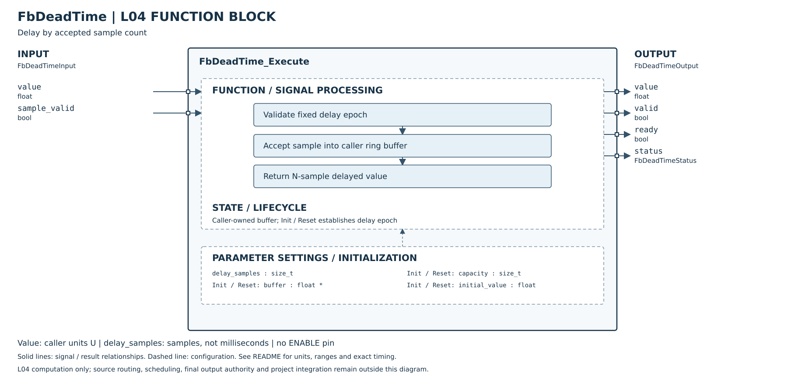

# FbDeadTime

## 摘要

已實作的 L04 功能方塊；本頁依公開 Header 補齊 SVG FBD 與介面導覽。圖示本身不代表產品串接或 MCU 實測完成。

Delay by accepted sample count。

測試摘要與細則：[FbDeadTime_HostTest.md](_UnitTest/TestResult/FbDeadTime_HostTest.md)。

## 介面與參數

### 輸入：FbDeadTimeInput

| 欄位 | C 型別 |
|---|---|
| `value` | `float` |
| `sample_valid` | `bool` |

### 輸出：FbDeadTimeOutput

| 欄位 | C 型別 |
|---|---|
| `value` | `float` |
| `valid` | `bool` |
| `ready` | `bool` |
| `status` | `FbDeadTimeStatus` |

### 設定：FbDeadTimeConfig

| 欄位 | C 型別 |
|---|---|
| `delay_samples` | `size_t` |

完整數值範圍、單位、初始化、禁能及錯誤行為請參閱 [公開 Header](../FbDeadTime.h) 與上述測試細則；呼叫端單位 U 不預設為溫度或 0.001°C。

## SVG FBD 維護說明

2026-10-26：方塊圖已依 [公開 Header](../FbDeadTime.h) 核對。左側為輸入、右側為輸出，外框內為功能分組與參數設定；Init／Reset 的資源與初值另列，不代表新增執行引腳。標示 API result 的列是函式回傳值，非 Output 結構成員。內部箭頭表示功能關係，精確優先序與錯誤行為以程式及本文契約為準。圖面使用英文介面名稱，說明沿用本頁繁體中文文件。
