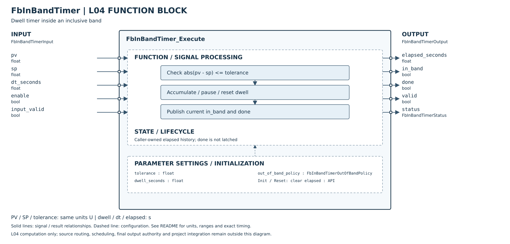

# FbInBandTimer Host 單元測試

## 介面與規則

- Config：tolerance 為有限非負 float，與 pv/sp 使用相同的呼叫端自訂單位；dwell_seconds 為有限非負 float 秒數。out_of_band_policy 明確選擇 PAUSE（出帶暫停）或 RESET（出帶歸零），其他列舉值拒絕。
- Input：pv、sp 有限；dt_seconds 有限且非負，單位秒，含負零均視為零。不設任意最大 dt；極大有限 dt 直接飽和。input_valid=false 代表呼叫端量測品質無效，回傳 INVALID_INPUT，保持歷史，不當作出帶重設。
- 本版是明確定義的通用離散方塊，非專有產品演算法複製。當次樣本代表整個 dt 間隔；在帶內（含兩端）便計入完整 dt，不推算兩次樣本間何時跨越邊界。
- State：呼叫端每實例各自持有；首次使用前零初始化並呼叫 Init。Init/Reset 清除累積時間與補償，不自行推進時間；NULL 不寫入。禁止外部修改 State 或呼叫期間同時修改資料，不支援參數儲存重疊。
- Output：成功 valid=true；elapsed_seconds 是 float 顯示值，done 才是完成依據，不能用顯示值等於 dwell 判斷完成。done 只在「目前在帶內且內部時間達 dwell」成立，非鎖存旗標。零 dwell 也只有目前在帶內才完成。
- PAUSE 出帶保留時間，但 done=false；再進帶可重新完成。RESET 出帶清除時間及補償，即使 dt=0。有效的零 dt 不累積，但仍判斷帶內、出帶重設與 dwell 下修。
- 優先序：指標 → 有效已初始化狀態 → enable → 設定 → 輸入/品質 → 計算。停用忽略所有數值／品質及 policy，凍結狀態；回傳 DISABLED、valid/in_band/done=false。錯誤也不更新狀態。若可寫 Output，顯示有效儲存時間供診斷，無效狀態則零；無效輸出不可作控制決策。
- 累積時間飽和於當前 dwell，並清除補償；dwell 下修會截斷歷史（包含 PAUSE 出帶、dt=0），上修後可繼續，但不恢復已丟棄的超額時間。SP/tolerance/policy 變化不自動建立新製程；新製程須明確 Reset。
- 以 double 做差避免 float 極值差溢位，以 Kahan 補償保留小於 float、甚至 double ULP 的增量；仍為有限精度運算，不保證任意小增量、任意長序列都完全精確。補償值必須有限且絕對值不大於 elapsed×DBL_EPSILON，累積值須有限且在 0..FLT_MAX；損壞狀態拒絕直到 Reset。
- 編譯期要求 DBL_MAX_EXP > FLT_MAX_EXP 且 DBL_MANT_DIG > FLT_MANT_DIG；不符合即拒絕編譯，避免 C99 允許 double/float 同精度的平台默默失去範圍保證。要求 round-to-nearest 且無 flush-to-zero；未驗證 MCU 的 FPU/FTZ 設定。本次驗證為 IEEE binary32/binary64、GCC 14.2.0、Linux x86_64。
- 無 heap、全域可變狀態或硬體相依；無 L03/L05、Register Map、NVM 串接。此平台 sizeof：Config=12、Input=16、State=24、Output=12 bytes，其他 ABI 可能不同；每次呼叫 O(1)。

## 摘要

- 2026-10-16：26 個編號案例全部 PASS，見下表及 [測試原始碼](../../../../../Tests/Unit/L04_FunctionBlock/test_fb_in_band_timer.c)。編號案例包含迴圈／多個邊界，不將每個 assert 誤算成獨立案例。
- strict C99：-Wall -Wextra -Werror -pedantic 通過。ASan+UBSan 在 ASAN_OPTIONS=detect_leaks=0 下通過，無診斷。
- 預設 LeakSanitizer 因環境 ptrace 不支援而失敗；不宣稱漏記憶體偵測通過。本 FB 沒有動態配置。
- C++11 consumer 包含 Header 並呼叫三個 API，連結 C99 object 通過。
- 已加入 CMake source/test；重新檢查仍無 cmake，因此未執行 CMake/CTest，不宣稱已通過。MCU/硬體及實際採樣品質驗證未執行。

## 測試細則

| ID | 實際項目與結果 | 結果 |
|---|---|---|
| UT-01 | 未初始化拒絕；Init 設為已初始化、時間與補償零 | PASS |
| UT-02 | 0.25 秒步長達 1 秒精確完成，重複呼叫維持飽和 | PASS |
| UT-03 | SP±tolerance 皆包含；相鄰帶外 float 暫停並清 done；再進帶零 dt 完成 | PASS |
| UT-04 | RESET 帶外且 dt=0 仍清除歷史；再進帶重新計時 | PASS |
| UT-05 | Reset 立即清零，無隱含計時 | PASS |
| UT-06 | dt=0 不累加；恢復只加當次 0.25 秒 | PASS |
| UT-07 | PAUSE 帶外 100 秒不計入，回帶延續 0.25→0.5 秒 | PASS |
| UT-08 | 停用忽略無效設定、policy、PV/SP/dt/quality，保持 0.5 秒，恢復正常 | PASS |
| UT-09 | PV、SP、dt 各測 NaN、+Inf、-Inf，均 atomic hold | PASS |
| UT-10 | 負 dt 拒絕；無效品質即使 RESET 帶外也保留歷史 | PASS |
| UT-11 | tolerance/dwell 各測 NaN、+Inf、-Inf，均拒絕 | PASS |
| UT-12 | 負 tolerance、負 dwell、未知 policy 拒絕 | PASS |
| UT-13 | Execute 所有 NULL 參數、Init/Reset NULL；含停用 NULL 仍錯誤 | PASS |
| UT-14 | 零 tolerance 只有相等算在帶；零 dwell 仍要求在帶 | PASS |
| UT-15 | PV=FLT_MAX、SP=-FLT_MAX 超帶不溢位；SP=0 恰在邊界 | PASS |
| UT-16 | dt=FLT_MAX 對 dwell=1 安全飽和，重複亦有限 | PASS |
| UT-17 | dwell=FLT_MAX 可達完成 | PASS |
| UT-18 | dwell 下修至 0.5，帶外 PAUSE、零 dt 也截斷並清補償 | PASS |
| UT-19 | dwell 上修恢復累加；SP 改變不自動重設 | PASS |
| UT-20 | 兩個實例與重設互不影響 | PASS |
| UT-21 | 32000 秒再加十萬次 0.00001 秒，顯示 32001 秒，不因 float ULP 卡住 | PASS |
| UT-22 | 約 1e20 秒加十萬次 1 秒，補償後增量確為 100000 秒，不因 double ULP 卡住 | PASS |
| UT-23 | 停用／零 dt 保留補償；下修飽和及 Reset 清除補償 | PASS |
| UT-24 | 負累積值、超 FLT_MAX、過大補償拒絕 | PASS |
| UT-25 | 時間/補償各測 NaN、±Inf；Reset 可恢復 | PASS |
| UT-26 | 內部 rounded 時間等於 dwell 但正補償 1 秒，dt=0/0.5 仍未完成，再 0.5 才完成 | PASS |

## 重現命令

在 repository root 執行（需 GCC/G++ 與 libm）：

```sh
mkdir -p /tmp/fb-next
cc -std=c99 -Wall -Wextra -Werror -pedantic \
  -I L04_FunctionBlock/Utility L04_FunctionBlock/Utility/FbInBandTimer.c \
  Tests/Unit/L04_FunctionBlock/test_fb_in_band_timer.c -lm -o /tmp/fb-next/timer
/tmp/fb-next/timer
cc -std=c99 -Wall -Wextra -Werror -pedantic \
  -fsanitize=address,undefined -fno-omit-frame-pointer -g \
  -I L04_FunctionBlock/Utility L04_FunctionBlock/Utility/FbInBandTimer.c \
  Tests/Unit/L04_FunctionBlock/test_fb_in_band_timer.c -lm -o /tmp/fb-next/timer-san
ASAN_OPTIONS=detect_leaks=0 /tmp/fb-next/timer-san
```

C++ linkage 煙霧測試：以 C99 編譯 `.c` 成 object，再以 C++11 編譯包含 Header 的 consumer，依序呼叫 Init、Reset、Execute，assert 狀態 OK 及零 dwell 在帶完成；不可只把 `.c` 全部改用 C++ 編譯替代此驗證。

```sh
cat > /tmp/fb-next/timer-link.cpp <<'CPP'
#include "FbInBandTimer.h"
int main() {
    FbInBandTimerState s = {};
    FbInBandTimerConfig c = {1.0f, 0.0f, FB_IN_BAND_TIMER_PAUSE};
    FbInBandTimerInput i = {0.0f, 0.0f, 0.0f, true, true};
    FbInBandTimerOutput o = {};
    return FbInBandTimer_Init(&s) != FB_IN_BAND_TIMER_OK ||
        FbInBandTimer_Reset(&s) != FB_IN_BAND_TIMER_OK ||
        FbInBandTimer_Execute(&c, &i, &s, &o) != FB_IN_BAND_TIMER_OK || !o.done;
}
CPP
cc -std=c99 -Wall -Wextra -Werror -pedantic -I L04_FunctionBlock/Utility \
  -c L04_FunctionBlock/Utility/FbInBandTimer.c -o /tmp/fb-next/timer.o
c++ -std=c++11 -Wall -Wextra -Werror -pedantic -I L04_FunctionBlock/Utility \
  /tmp/fb-next/timer-link.cpp /tmp/fb-next/timer.o -lm -o /tmp/fb-next/timer-link
/tmp/fb-next/timer-link
```

補充實測：同一 26 案例亦以 -O2 編譯通過（未開啟 fast-math；偵測到 __FAST_MATH__ 時拒絕編譯，亦不得以其他選項開啟不安全重排／略過有限性檢查）。既有 FbSetpointRamp 44、FbOutputLimiter 25 及 FbLogic/FbDivide/FbWeightedSum/FbSelector/FbMovingAverage/FbAlarm 六套既有測試以 strict C99 全數執行成功；未更改它們的檔案，不代表所有系統／硬體測試均已驗證。

額外編譯檢查：以 -ffast-math 編譯被預期的 __FAST_MATH__ 防護拒絕，並非測試失敗。
