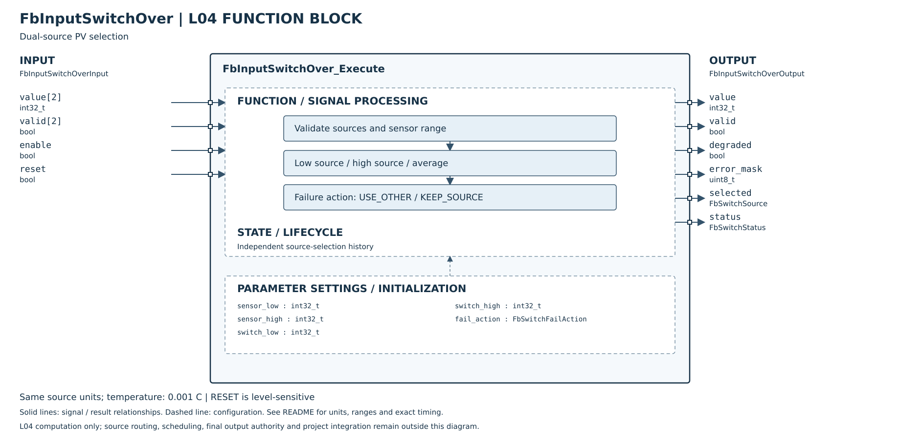

# FbInputSwitchOver

## 摘要

**完成狀態（2026-10-27 用語統一）：L04 實作完成；Host 單元測試通過。**

| 追蹤項目 | 狀態 |
|---|---|
| 產品串接 | 部分完成：CH0 PV 處理 adapter 已提供可選切換及 Host 整合測試；正式多通道／Register 整合未完成 |
| MCU 實測 | 尚未實測 |

狀態用語見 [完成狀態與驗證定義](../../VERIFICATION_STATUS.md)；[測試報告](HOST_TEST.md)。本次為文件整理，不代表重新執行測試。

L04 單實例雙輸入範圍切換已實作，正常時依低來源及高來源判斷，中間區取算術平均；支援切換有效來源或維持原選擇。Host 與 ASan／UBSan 驗證通過。這是本專案正式契約，不宣稱 DTDM04 未明訂的等號／故障／恢復行為完全相容。

宣告／實作：同層 ../FbInputSwitchOver.h、../FbInputSwitchOver.c。無硬體／通訊／Register／NVM 相依，無動態配置。L05 來源路由與 MCU／產品整合尚未完成。

## 參數與引腳

| 類別 | 欄位 | 定義 |
|---|---|---|
| Config | sensor_low／sensor_high | 來源數值合法範圍，含端點；超界視該來源失效 |
| Config | switch_low／switch_high | 必須 sensor_low≤switch_low≤switch_high≤sensor_high；允許相等 |
| Config | fail_action | USE_OTHER=0、KEEP_SOURCE=1；其他值拒絕 |
| Input | value[2] | int32 來源值，同量綱同刻度；溫度為 0.001°C |
| Input | valid[2] | 外層先處理斷線、過期、錯誤碼、單位不一致及時間對齊 |
| Input | enable | false：輸出零、invalid、NONE、DISABLED，清除選擇歷史 |
| Input | reset | 電位有效命令，每次 true 都清除歷史，該次零／invalid／RESET；enable=false 優先 |
| Output | value／valid | 只有 OK 時有效；其餘狀態 value=0，不保留舊控制值 |
| Output | selected | SOURCE1=0、SOURCE2=1、BOTH=2、NONE=3；無效輸出仍可回報維持中的選擇 |
| Output | error_mask | bit0=來源1失效、bit1=來源2失效；包含 valid=false 及超出 Sensor 範圍 |
| Output | degraded | 只有結果仍有效且有來源失效時 true；兩來源有效時 false |
| Output | status | OK／DISABLED／RESET／INVALID_ARGUMENT／INVALID_CONFIG／INVALID_INPUT |

建立 FbInputSwitchOver 時先零初始化或呼叫 Init。各實例持有自己的歷史與設定快照；相同來源指到兩個輸入由 L05 決定，可用但不提供冗餘。其他工程量可用相同 API，但不可與溫度或不同尺度混算。

## 正常選擇次序

兩來源皆有效時，每次重新判斷，無隱含遲滯或濾波：

1. PV1≤switch_low：選 SOURCE1，即使 PV2 已超過高切換值也仍優先低來源。
2. 否則 PV2>switch_high：選 SOURCE2。
3. 其餘 BOTH，value=(int64(PV1)+PV2)/2，結果朝零取整；例如 -3 與 -2 得 -2。

範例低門檻 200000、高門檻 400000（200°C／400°C）：PV1=200000 選來源1；PV1=200001、PV2=400000 取平均；PV2=400001 選來源2。兩來源嚴重不一致不另設誤差門檻；若需差值警報，應用獨立警報功能。

## 故障、初始化與恢復

| 情況 | USE_OTHER | KEEP_SOURCE |
|---|---|---|
| 僅來源1失效 | 選來源2，valid=true、degraded=true | 保留選擇；只有原選來源2才有效 |
| 僅來源2失效 | 選來源1，valid=true、degraded=true | 保留選擇；只有原選來源1才有效 |
| 原選 BOTH，有任一失效 | 選健康的一側 | 保留 BOTH，結果無效，不用剩餘值假裝平均 |
| 雙方失效 | NONE、結果無效 | 保留原選擇，結果無效 |
| 雙方恢復 | 立即按正常次序重新判斷 | 同左 |

初次啟用／設定變更後，KEEP_SOURCE 若遇來源故障以 SOURCE1 為初始選擇；來源1失效則無效，來源1健康且僅來源2故障則有效且 degraded。這是明確初始政策，不使用未驗證數值選源。

任何設定欄位改變皆先重設選擇再計算；比較實際欄位，不比較結構 padding。無效設定清除歷史；參數修正後視為新啟用。disable／reset 清除設定快照。兩來源單次故障不自動清除 KEEP 歷史。

輸出 NULL 回 INVALID_ARGUMENT，不更動實例；其他 NULL 參數在有 output 時清零並回 INVALID_ARGUMENT，也不改實例。有效指標／實例／設定／輸入／輸出記憶體不可重疊，並由呼叫端保證更新同步。

## 外層串接及限制

L05 提供兩個已對齊單位與品質的 Snapshot；在必要的輸入折線處理後接此 FB，再把 Switch PV 提供控制迴路。不得覆寫原 Sensor Snapshot；Sensor Fault／Safety 依原架構處理。此 FB 不知道站號、模組、來源編號、時間戳或 PDO，也不直接決定輸出許可。

參數驗證在每次執行都做，但 Register Pending／Apply、設定持久化及來源一致性不在 L04。無預設硬體量程，應依產品 Sensor 與工程量配置；不得把 DTDM04 sentinel 當 int32 溫度傳入。

[Host 測試摘要及細則](HOST_TEST.md)。

## SVG FBD 維護說明

2026-10-26：方塊圖已依 [公開 Header](../FbInputSwitchOver.h) 核對。左側為輸入、右側為輸出，外框內為功能分組與參數設定；Init／Reset 的資源與初值另列，不代表新增執行引腳。標示 API result 的列是函式回傳值，非 Output 結構成員。內部箭頭表示功能關係，精確優先序與錯誤行為以程式及本文契約為準。圖面使用英文介面名稱，說明沿用本頁繁體中文文件。
