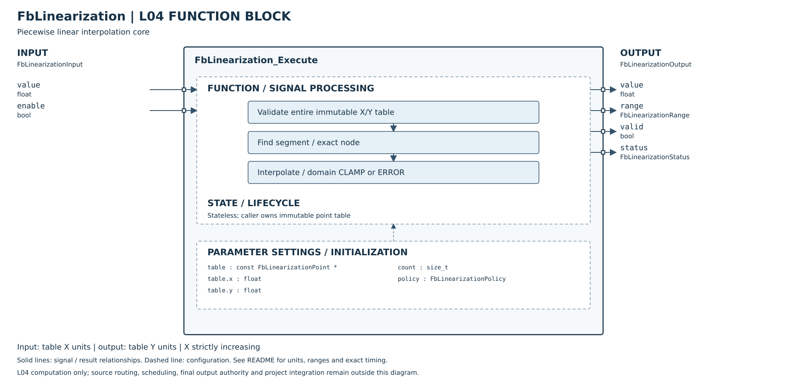

# FbLinearization 主機單元測試報告

## 介面與規則

- `FbLinearizationPoint`：`float x, y`。x 使用輸入單位，y 使用輸出單位，兩種單位均由呼叫端定義。所有 x/y 必須有限；x 必須嚴格遞增，y 可上升、下降、持平或非單調。
- `FbLinearizationConfig`：`const FbLinearizationPoint *table`、`size_t count`、`FbLinearizationPolicy policy`。至少兩個節點；僅接受 `FB_LINEARIZATION_CLAMP` 或 `FB_LINEARIZATION_ERROR`，沒有隱式外插或其他策略。
- `FbLinearizationInput`：有限的 `float value` 與 `bool enable`。
- `FbLinearizationOutput`：`float value`、`FbLinearizationRange range`、`bool valid`、`FbLinearizationStatus status`。
- `FbLinearization_Execute(const FbLinearizationConfig *, const FbLinearizationInput *, FbLinearizationOutput *)` 回傳 `FbLinearizationStatus`。本模組無狀態，不需要 Init／Reset；每次呼叫只依當次設定、資料表及輸入計算。
- 範圍為 `FB_LINEARIZATION_RANGE_UNKNOWN / BELOW / WITHIN / ABOVE`。兩端點都屬 WITHIN，任一節點精確命中時直接複製該節點 y，包含負零符號。
- CLAMP：低於首節點時取首節點 y，range=BELOW；高於末節點時取末節點 y，range=ABOVE。兩者都是 OK、valid=true，仍不進行外插。
- ERROR：任一超界輸入回傳 `FB_LINEARIZATION_OUT_OF_RANGE`，和所有其他非 OK 結果一樣，value=正零、valid=false、range=UNKNOWN。不可使用無效輸出作控制值，也不可把 UNKNOWN 解讀成 WITHIN。
- 檢查順序：NULL Output → NULL Config/Input → enable → 全表設定驗證 → 輸入有限性 → 範圍／內插。可寫 Output 的 status 永遠等於回傳值；NULL Output 只回傳 INVALID_ARGUMENT、不寫入記憶體。
- 停用回傳 DISABLED，忽略 table、count、policy 與所有數值欄位，輸出仍為零／無效／UNKNOWN。Config/Input/Output 本身的 NULL 錯誤優先於 enable。
- 每次啟用均先檢查整張表，即使輸入超界、命中第一節點，或只使用前段，尾端的無效資料仍回傳 INVALID_CONFIGURATION。沒有快取上一次驗證結果。

### 狀態碼

| 狀態碼（共同前綴 `FB_LINEARIZATION_`） | 意義 |
|---|---|
| OK | 有效內插、精確節點或 CLAMP 結果 |
| DISABLED | 已停用，未驗證／存取表格內容 |
| INVALID_ARGUMENT | Config、Input 或 Output 為 NULL |
| INVALID_CONFIGURATION | 空 table、count<2、不支援的策略、非有限節點或非嚴格遞增 x |
| INVALID_INPUT | 啟用且設定有效，但輸入 value 為 NaN 或正／負無限大 |
| OUT_OF_RANGE | ERROR 策略下輸入超出首末 x 範圍 |

## 驗證摘要

- 日期：2026-10-16。平台：Linux x86_64；GCC／G++ 14.2.0。
- 59 個具編號案例全部 PASS；部份案例包含多個輸入或掃描，不將每個子輸入另算為案例。
- 嚴格 C99：`-O0` 與 `-O2`，均使用 `-Wall -Wextra -Werror -pedantic`，全部通過。
- AddressSanitizer + UndefinedBehaviorSanitizer：59 案例通過，無診斷；使用 `ASAN_OPTIONS=detect_leaks=0`，沒有執行／宣稱通過 LeakSanitizer。此模組本身沒有動態配置。
- C++11 標頭／C99 實作混合連結煙霧測試通過；實作先由 C 編譯器產生 object，再由 G++ 編譯 C++ 呼叫端並連結，不是把 C 原始碼當成 C++ 測試。
- 生產實作僅用標準標頭與內建浮點判斷；單元測試的 `nextafterf` 需要 `-lm`。混合連結煙霧測試不需要 `-lm`。
- 本報告的驗證為直接編譯；未執行 CMake／CTest，因本執行環境沒有 cmake。整體建置項目由整合工作處理，本報告不宣稱完整平台測試已通過。
- 測試來源：[test_fb_linearization.c](../../../../../Tests/Unit/L04_FunctionBlock/test_fb_linearization.c)。

## 數值演算法與支援條件

若只以 `yL + ((x-xL)/(xR-xL))*(yR-yL)` 計算，即使改用 double，`x=y=±FLT_MAX`、輸入 `1` 仍可能因大數相減而錯誤得到零。因此內插分子採用四項展開：

`yL*xR - yR*xL + x*yR - x*yL`

先以 double 計算四個乘積，再使用 general TwoSum 逐項建立最多四個 double 的非重疊展開，保留大數消去後的小項。最後由小至大合併，除以 double 的 `xR-xL`。直接命中節點時不走此計算。

轉回 float 之前，先把 double 結果限制於兩個相鄰節點 y 的最小／最大值之內；這一步也涵蓋接近 `±FLT_MAX` 的同號端點。結果不超越所在段的 y 界限；極端反號座標／輸出不會先以 float 作差而溢位。

支援條件與限制：

- 已驗證 IEEE binary32 float／binary64 double、round-to-nearest 與漸進下溢。不是僅憑 C99 就假設 double 一定比 float 寬。
- 編譯期要求 `FLT_RADIX==2`、`DBL_MANT_DIG>=2*FLT_MANT_DIG`、`DBL_MAX_EXP>=2*FLT_MAX_EXP+2`、`DBL_MIN_EXP<=2*(FLT_MIN_EXP-FLT_MANT_DIG)`，使有限 float 乘積可由 double 精確容納，並有四項相加與極小乘積所需範圍。不符者會以 `#error` 拒絕編譯。
- 不支援 fast-math、任意浮點重排／結合、flush-to-zero 或非預期的執行期捨入模式。`__FAST_MATH__` 會被編譯期拒絕；其他不設定此巨集的非安全旗標仍須由建置端排除。
- 展開加法改善災難性消去，不代表所有輸入的整條計算都是精確實數運算或最終 float 保證正確捨入。分母、合併及除法仍有有限精度，float 輸出也有量化。
- MCU 編譯器、硬體 FPU／FTZ 設定、次正規數行為、實際堆疊與週期時間未在本次主機測試驗證。不得直接把主機結果視為硬體／控制安全認證。

## 編號案例與實際結果

下表每列對應測試程式真正執行並印出的 UT 編號。所有失敗案例均驗證回傳值=status、value=正零、valid=false、range=UNKNOWN；成功輔助函式驗證 OK、valid=true、有限且精確符合預期的 value 及 range。

| ID | 實際設定／輸入 | 預期且實測結果 | 結果 |
|---|---|---|---|
| UT-01 | 兩點 (0,10)、(10,30)，輸入2.5 | value=15，WITHIN | PASS |
| UT-02 | 首點輸入0 | 原值10，WITHIN | PASS |
| UT-03 | 末點輸入10 | 原值30，WITHIN | PASS |
| UT-04 | 五個非等距、非單調 y 節點逐一命中 | 五個 y 全部原值保留 | PASS |
| UT-05 | (-10,40) 到 (-3,-5)，輸入-6.5 | 下降內插17.5 | PASS |
| UT-06 | (-3,-5) 到 (2,15)，輸入1 | 上升內插11 | PASS |
| UT-07 | (2,15) 到 (8,15)，輸入5 | 平台段15 | PASS |
| UT-08 | (8,15) 到 (20,-9)，輸入14 | 最後一段內插3 | PASS |
| UT-09 | 內部節點輸入-3 | 原值-5 | PASS |
| UT-10 | CLAMP，輸入-FLT_MAX | 首點y=40，BELOW | PASS |
| UT-11 | CLAMP，輸入+FLT_MAX | 末點y=-9，ABOVE | PASS |
| UT-12 | ERROR，輸入-11 | OUT_OF_RANGE，UNKNOWN | PASS |
| UT-13 | ERROR，輸入21 | OUT_OF_RANGE，UNKNOWN | PASS |
| UT-14 | ERROR，分別輸入首末x=-10、20 | 端點仍OK／WITHIN，y=40、-9 | PASS |
| UT-15 | policy轉型為-1 | INVALID_CONFIGURATION | PASS |
| UT-16 | policy轉型為2 | INVALID_CONFIGURATION | PASS |
| UT-17 | table=NULL | INVALID_CONFIGURATION | PASS |
| UT-18 | count=0 | INVALID_CONFIGURATION | PASS |
| UT-19 | count=1 | INVALID_CONFIGURATION | PASS |
| UT-20 | 第三點x等於第二點x=1 | 拒絕重複x | PASS |
| UT-21 | 第三點x=0.5，小於第二點1 | 拒絕逆序x | PASS |
| UT-22 | 相鄰x=-0、+0 | 視為相等，拒絕 | PASS |
| UT-23 | 四個x位置各放NaN／+Inf／-Inf，共12組 | 全部INVALID_CONFIGURATION | PASS |
| UT-24 | 四個y位置各放NaN／+Inf／-Inf，共12組 | 全部INVALID_CONFIGURATION | PASS |
| UT-25 | 尾點y=NaN，CLAMP且輸入低於首點 | 先全表驗證，不回傳夾限值 | PASS |
| UT-26 | 同一壞表，CLAMP且輸入高於末點 | INVALID_CONFIGURATION | PASS |
| UT-27 | 同一壞表，ERROR且超界 | 設定錯誤優先於OUT_OF_RANGE | PASS |
| UT-28 | 尾點y=NaN，輸入精確命中首點 | 仍拒絕整張壞表 | PASS |
| UT-29 | 尾點y=NaN，輸入落在第一段 | 仍拒絕整張壞表 | PASS |
| UT-30 | 同時壞表與input=NaN | 設定錯誤優先於輸入錯誤 | PASS |
| UT-31 | 有效表，輸入NaN／+Inf／-Inf | 三者皆INVALID_INPUT | PASS |
| UT-32 | disabled，NULL表、size_t最大count、無效policy、-Inf輸入 | DISABLED，不讀取表格 | PASS |
| UT-33 | disabled，表含NaN x及Inf y且policy無效 | DISABLED，忽略所有設定數值 | PASS |
| UT-34 | enabled，Config=NULL | INVALID_ARGUMENT | PASS |
| UT-35 | Input=NULL | INVALID_ARGUMENT | PASS |
| UT-36 | Output=NULL | 回傳INVALID_ARGUMENT，不寫入 | PASS |
| UT-37 | disabled且Config=NULL | NULL錯誤優先於停用 | PASS |
| UT-38 | 三個引數均NULL | 回傳INVALID_ARGUMENT | PASS |
| UT-39 | 前述錯誤後換回有效兩點表 | 2.5再次得到15，沒有殘留狀態 | PASS |
| UT-40 | x=±FLT_MAX、y=±100、輸入0 | 有限中點0 | PASS |
| UT-41 | x=±1、y=±FLT_MAX、輸入0 | 有限中點0 | PASS |
| UT-42 | x=y=±FLT_MAX、輸入0 | 有限中點0 | PASS |
| UT-43 | 上述極值表，輸入±FLT_MAX/2 | 原比例保留為±FLT_MAX/2 | PASS |
| UT-44 | 極值x，y反向，輸入0及FLT_MAX/2 | 0及-FLT_MAX/2 | PASS |
| UT-45 | 極值x，兩個y均+FLT_MAX | 有限且不超越+FLT_MAX | PASS |
| UT-46 | 極值x，兩個y均-FLT_MAX | 有限且不超越-FLT_MAX | PASS |
| UT-47 | y為+FLT_MAX及其前一個float，掃描1025點 | 全部有限、OK、WITHIN且不超越y段界 | PASS |
| UT-48 | y為-FLT_MAX及其下一個float，掃描1025點 | 全部有限、OK、WITHIN且不超越y段界 | PASS |
| UT-49 | x=0到4倍最小正次正規float，輸入1倍 | y由0到4，正確內插1 | PASS |
| UT-50 | x=0到4、y=0到4倍最小正次正規float，輸入1 | 保留最小正次正規輸出 | PASS |
| UT-51 | 相鄰可表示x=1及nextafterf(1,2)，y=±FLT_MAX | 兩節點分別精確複製 | PASS |
| UT-52 | 三個節點y均為-0，逐一命中 | 三者均保留signbit | PASS |
| UT-53 | input=-0命中x=+0、y=-0 | WITHIN且輸出仍為-0 | PASS |
| UT-54 | 呼叫間改y=10→20，再把x改為重複 | 先得到5→10，再拒絕設定；每次重新讀表驗證 | PASS |
| UT-55 | 兩組獨立Config交替各執行100次 | 同輸入5分別得到15、20，不互相影響 | PASS |
| UT-56 | ±FLT_MAX上升／下降／平台共四段，各掃描1025點 | 全部有限且在各段y界內 | PASS |
| UT-57 | 全範圍恆等映射，輸入±1、±FLT_MIN、±最小次正規值 | 六個小輸入原值保留，不因大數消去歸零 | PASS |
| UT-58 | 全範圍負恆等映射，相同六個輸入 | 精確得到各自的相反數 | PASS |
| UT-59 | x=-FLT_MAX/2到FLT_MAX/4、y=-FLT_MAX到FLT_MAX/2 | 六個小輸入均精確得到2x；非對稱區間 | PASS |

## 儲存、生命週期與並行使用

- Config／Input／Output 由呼叫端持有，所有非 NULL 引數須指向正確型別、可存取且互不重疊的有效儲存。Output 必須可寫；不得以強制轉型讓 Output 蓋住 Config、Input 或表格。
- 啟用呼叫時，table 必須指向至少 count 個連續且可讀的 Point；在整次呼叫期間，Config、Input 與全部表格內容不得被修改或釋放。NULL／值域檢查無法判斷懸空指標、錯誤型別、越界count或實際配置長度；這些屬呼叫端前置條件。
- 停用不讀取表格及其他設定欄位，所以表格內容與長度要求只適用啟用呼叫；Config、Input、Output 物件本身仍須有效。
- 模組不保留任何指標或輸出歷史。呼叫完成後可安全切換 Config/table，或在無其他讀者時更新表格；下一次啟用會重新驗證。
- 可由多個呼叫共用不變的 Config／Input／table，但每個同時執行的呼叫須有不同 Output。任何資料修改、共享Output寫入與其他存取均須由呼叫端同步，const 不代表自動同步。
- 沒有 heap、可變靜態狀態或硬體相依。每次啟用先作 O(count) 全表驗證，再作最多 O(count) 段落搜尋；展開最多四個 double、固定次數運算，額外空間 O(1)。
- 本次 x86_64 sizeof：Point=8、Config=24、Input=8、Output=16 bytes。ABI padding／指標寬度依目標平台而異，不能把主機大小當作MCU量測。
- 未連接 L03／L05、Register Map、NVM、排程器或硬體；不負責設定資料更新的鎖定、資料來源合法性或控制迴路安全。

## 重現指令

在 repository 根目錄執行；產物放在 `/tmp`。測試使用 assert，不可加入 `-DNDEBUG`。

```sh
for opt in 0 2; do
  cc -O$opt -std=c99 -Wall -Wextra -Werror -pedantic \
    -I L04_FunctionBlock/Utility \
    L04_FunctionBlock/Utility/FbLinearization.c \
    Tests/Unit/L04_FunctionBlock/test_fb_linearization.c \
    -lm -o /tmp/test_fb_linearization_o$opt
  /tmp/test_fb_linearization_o$opt
done

cc -O0 -std=c99 -Wall -Wextra -Werror -pedantic \
  -fsanitize=address,undefined -fno-omit-frame-pointer -g \
  -I L04_FunctionBlock/Utility \
  L04_FunctionBlock/Utility/FbLinearization.c \
  Tests/Unit/L04_FunctionBlock/test_fb_linearization.c \
  -lm -o /tmp/test_fb_linearization_san
ASAN_OPTIONS=detect_leaks=0 /tmp/test_fb_linearization_san
```

兩種最佳化與 sanitizer 的最後一行均為：

```text
FbLinearization: 59 cases passed; sizeof Point=8 Config=24 Input=8 Output=16
```

C++ 混合連結測試：

```sh
cat > /tmp/test_fb_linearization_cpp.cpp <<'EOF'
#include "FbLinearization.h"
#include <cassert>
int main()
{
    const FbLinearizationPoint points[] = {{-1.0F, 10.0F}, {1.0F, 20.0F}};
    const FbLinearizationConfig config = {points, 2, FB_LINEARIZATION_CLAMP};
    const FbLinearizationInput input = {0.0F, true};
    FbLinearizationOutput output;
    assert(FbLinearization_Execute(&config, &input, &output) == FB_LINEARIZATION_OK);
    assert(output.valid && output.value == 15.0F &&
           output.range == FB_LINEARIZATION_RANGE_WITHIN &&
           output.status == FB_LINEARIZATION_OK);
    return 0;
}
EOF
cc -O0 -std=c99 -Wall -Wextra -Werror -pedantic \
  -I L04_FunctionBlock/Utility -c L04_FunctionBlock/Utility/FbLinearization.c \
  -o /tmp/fb_linearization_c.o
g++ -std=c++11 -Wall -Wextra -Werror -pedantic \
  -I L04_FunctionBlock/Utility /tmp/test_fb_linearization_cpp.cpp \
  /tmp/fb_linearization_c.o -o /tmp/test_fb_linearization_cpp
/tmp/test_fb_linearization_cpp
```

實際執行退出碼為0；全部斷言成立。
