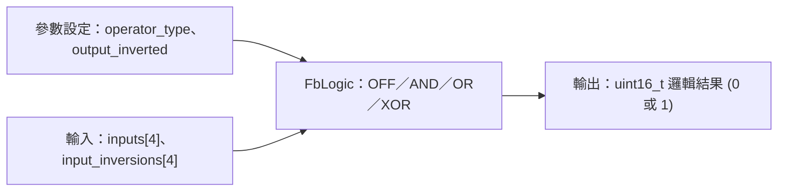

# FbLogic Host Unit Test

## FB 介面方塊圖



| 類別 | 欄位 | 用途／規則 |
|---|---|---|
| 參數設定 | `operator_type` | 選擇 OFF、AND、OR 或 XOR。 |
| 參數設定 | `output_inverted` | 對運算結果做輸出反相。 |
| 輸入 | `inputs[4]` | 四路 16 位元輸入；每路只取 bit 0。 |
| 輸入 | `input_inversions[4]` | 四路輸入反相設定；每路只取 bit 0。 |
| 輸出 | `uint16_t` 回傳值 | 正規化為 0 或 1；無效操作碼或空指標回傳 0。 |

## 摘要

- **測試結果：** PASS
- **測試方式：** GCC 嚴格 C99 編譯並執行 host test。
- **編譯選項：** `-std=c99 -Wall -Wextra -Werror -pedantic`
- **測試範圍：** 4 組測試，涵蓋四種運算、輸入／輸出反相、bit 0 規則及輸入不修改、無效操作碼與空指標。
- **測試程式：** [test_fb_logic.c](../../../../../Tests/Unit/L04_FunctionBlock/test_fb_logic.c)

## 測試細則

| 測項 | 驗證內容 | 結果 |
|---|---|---|
| UT-01 | OFF 輸出 0；AND 全真輸出 1、含假值輸出 0。 | PASS |
| UT-02 | OR 混合輸入輸出 1；XOR 偶數個真值輸出 0、奇數個真值輸出 1。 | PASS |
| UT-03 | 各輸入反相設定及輸出反相。 | PASS |
| UT-04 | 輸入及反相值僅使用 bit 0；執行前後輸入陣列不變。 | PASS |
| UT-05 | 無效運算碼、輸入陣列為 NULL、反相陣列為 NULL 時安全回傳 0。 | PASS |

## 重現方式

在 Platform repository 根目錄執行：

```sh
cc -std=c99 -Wall -Wextra -Werror -pedantic \
  -I L04_FunctionBlock/Utility \
  L04_FunctionBlock/Utility/FbLogic.c \
  Tests/Unit/L04_FunctionBlock/test_fb_logic.c \
  -o /tmp/test_fb_logic
/tmp/test_fb_logic
```
