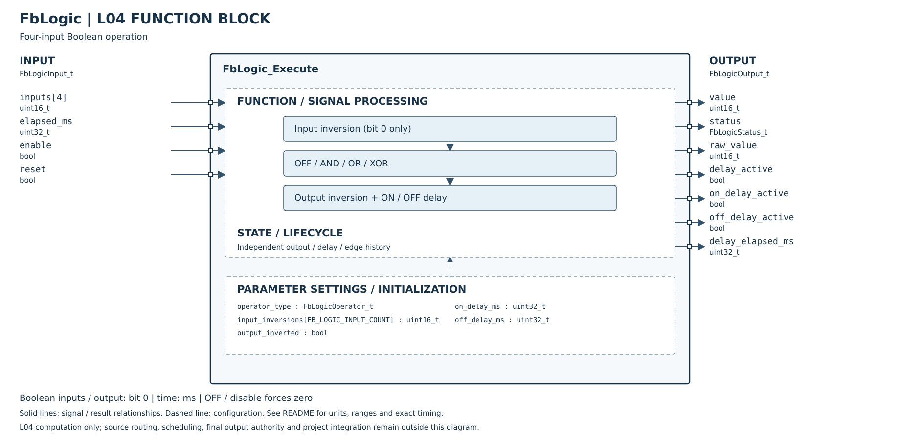

# FbLogic Host Unit Test

## 摘要

- **日期：** 2026-10-22。
- **功能狀態：** 以 DTDM04 單一邏輯運算功能為基準，已補上 L04 ON／OFF 延遲及生命週期狀態；OFF 優先強制 0、不受反向與延遲影響的專案契約已完成，手冊未明訂此組合，尚不宣稱設備完全相容。C7G 功能由獨立 FbC7gLogic 規劃，不列入本 FB 缺項。詳見 [手冊功能對照](../../MANUAL_COMPLIANCE.md)。
- **Host 測試：** PASS，2048 組布林真值組合及 9 組時間／狀態測試。
- **範圍：** 嚴格 C99 與 ASan／UBSan 檢查；不代表 MCU 實測或 L05 整合完成。
- **測試程式：** [test_fb_logic.c](../../../../../Tests/Unit/L04_FunctionBlock/test_fb_logic.c)。
- **分層：** 輸入來源、16 組配置、結果發布及 PID 前後排程由 L05 負責，不列入 L04 完成條件。

## 介面與執行契約

| 類別 | 欄位 | 規則 |
|---|---|---|
| 設定 `FbLogicConfig_t` | `operator_type` | OFF／AND／OR／XOR；原有 enum 數值維持 0～3。OFF 強制 0，回報 DISABLED。 |
| 設定 | `input_inversions[4]` | 各輸入在運算前反向，只使用 bit 0。 |
| 設定 | `output_inverted` | 布林運算之後、延遲之前反向。 |
| 設定 | `on_delay_ms`、`off_delay_ms` | 0～UINT32_MAX 毫秒；0 表示立即切換。 |
| 輸入 `FbLogicInput_t` | `inputs[4]` | 各輸入只使用 bit 0，輸入資料不被修改。 |
| 輸入 | `elapsed_ms` | L05 提供距前次呼叫的實際時間；0 不推進計時。 |
| 輸入 | `enable` | false 時立即輸出 0 並清除計時，不等待 OFF 延遲。 |
| 輸入 | `reset` | 上升緣清除輸出與計時；該掃描回傳 RESET、輸出 0；持續為 true 不重複重設。 |
| 狀態 `FbLogic_t` | 每個 FB 獨立實例 | 初始化後使用；固定記憶體，無硬體 Timer、無動態配置、無阻塞等待。 |
| 輸出 `FbLogicOutput_t` | `value`、`raw_value` | 最終輸出／延遲前結果，皆為 0 或 1。停用、重設與錯誤掃描皆為 0。 |
| 輸出 | `delay_active`、`delay_elapsed_ms` | 等待切換期間的計時資訊；取消或切換完成後歸零。另以 on_delay_active／off_delay_active 區分方向，兩者不會同時為 true。 |
| 輸出 | `status` | OK／DISABLED／INVALID_ARGUMENT／RESET／INVALID_CONFIGURATION。NULL 屬參數錯誤；非法運算種類屬設定錯誤。延遲進行中為 OK，另由 delay_active 表示。 |

1. 首次觀察到目標值不同於目前輸出時，計時從 0 開始；不計入該次 `elapsed_ms`，也不回算訊號變化時刻。
2. 後續目標值持續不變時累積實際間隔；累積值達到或超過設定值，於該次呼叫切換輸出。
3. 等待期間訊號回到目前輸出值時，立即取消等待；下次變化重新計時。
4. 設定內容改變時清除輸出與計時，依新設定重新判斷；有非零延遲時從 0 開始，零延遲可在該掃描立即輸出新結果。
5. 無效參數會清除內部狀態，恢復有效輸入後重新開始；停用時不檢查運算設定，優先輸出 0。
6. OFF 優先強制 value／raw_value 為 0，清除計時並回報 DISABLED；重新選擇有效運算時，從零重新計時。這是專案契約，並非手冊明確規定的 OFF＋反向行為。輸入反向的高位元既不參與運算，也不觸發設定變更重置。
7. RESET 邊緣會在每次有效 input 呼叫中追蹤，包含停用期間；若停用期間已觀察到 RESET 為 true，再啟用且仍維持 true，不會視為新上升緣。

例如 ON 延遲 100 ms，週期 20 ms：首次觀察為 1 記為 t=0，之後 t=20／40／60／80 ms 維持 0，t=100 ms 輸出 1。實際切換時間受呼叫週期解析度限制；FB 只處理呼叫時觀察到的輸入，無法辨識兩次呼叫之間未取樣的短脈波。

## 呼叫方式與相容性

`FbLogic_Execute()` 已由無狀態引數介面改為 instance／config／input／output；舊呼叫端需要遷移。本專案檢索到的實際呼叫端為 Host 測試，已同步更新，尚未新增 L05 Logic adapter。

```c
FbLogic_t logic;
FbLogicConfig_t config = {0};
FbLogicInput_t input = {0};
FbLogicOutput_t output;

FbLogic_Initialize(&logic); /* 僅初始化時呼叫，不要每個週期重設 */
FbLogic_DefaultConfig(&config); /* OFF，無反向，零延遲 */
config.operator_type = FB_LOGIC_OPERATOR_OR;
config.on_delay_ms = 100U;
config.off_delay_ms = 200U;
input.enable = true;
input.inputs[0] = 1U;
input.elapsed_ms = 20U; /* 每次由 L05 更新實際間隔及輸入 */
(void)FbLogic_Execute(&logic, &config, &input, &output);
```

L05 若接收手冊 0.1 秒格式的參數，先以足夠寬度換算成毫秒、檢查是否超出 UINT32_MAX，再傳給 L04。狀態與引數儲存區不可重疊，同一實例的呼叫需循序執行。

## 測試細則

| 測項 | 驗證內容 | 結果 |
|---|---|---|
| UT-01 | 4 種運算 × 16 組輸入 × 16 組輸入反向 × 2 組結果反向，共 2048 組；確認 bit 0 規則及輸入／設定不修改。 | PASS |
| UT-02 | ON 100 ms、OFF 60 ms；首掃描不計時、門檻前 1 ms、恰好到期及初始大 elapsed。 | PASS |
| UT-03 | 短脈波取消、ON／OFF 等待取消後重啟、0 ms、不固定間隔及超過門檻。 | PASS |
| UT-04 | ON／OFF 等待期間停用、立即清零、重新啟用重新計時、RESET 上升緣及持續高電位。 | PASS |
| UT-05 | 延遲、運算種類、輸入反向與結果反向變更後清除舊狀態。 | PASS |
| UT-06 | 非法運算回報 INVALID_CONFIGURATION、NULL 引數回報 INVALID_ARGUMENT；錯誤時清除狀態及有效輸入恢復。 | PASS |
| UT-07 | UINT32_MAX 的 ON／OFF 門檻、超大 elapsed 避免溢位、多實例計時隔離。 | PASS |
| UT-08 | 結果反向先於 ON／OFF 延遲，兩方向皆驗證。 | PASS |
| UT-09 | ON／OFF 延遲皆為 0 時，連續掃描立即切換。 | PASS |
| UT-10 | 預設設定、OFF＋反向＋最大延遲仍強制零、ON／OFF 切入 OFF 立即取消、OFF 期間 Reset 邊緣追蹤、忽略反向高位元不重啟計時、停用優先於非法設定。 | PASS |

## 重現方式

在 Platform repository 根目錄執行：

```sh
cc -std=c99 -Wall -Wextra -Werror -pedantic \
  -I L04_FunctionBlock/Utility \
  L04_FunctionBlock/Utility/FbLogic.c \
  Tests/Unit/L04_FunctionBlock/test_fb_logic.c \
  -o /tmp/test_fb_logic
/tmp/test_fb_logic
```

記憶體／未定義行為檢查：編譯時加上 `-fsanitize=address,undefined -fno-omit-frame-pointer`。目前執行環境的 LeakSanitizer 無法讀取程序資訊，執行時設 `ASAN_OPTIONS=detect_leaks=0`；ASan／UBSan 仍啟用，FbLogic 本身不使用動態記憶體。
