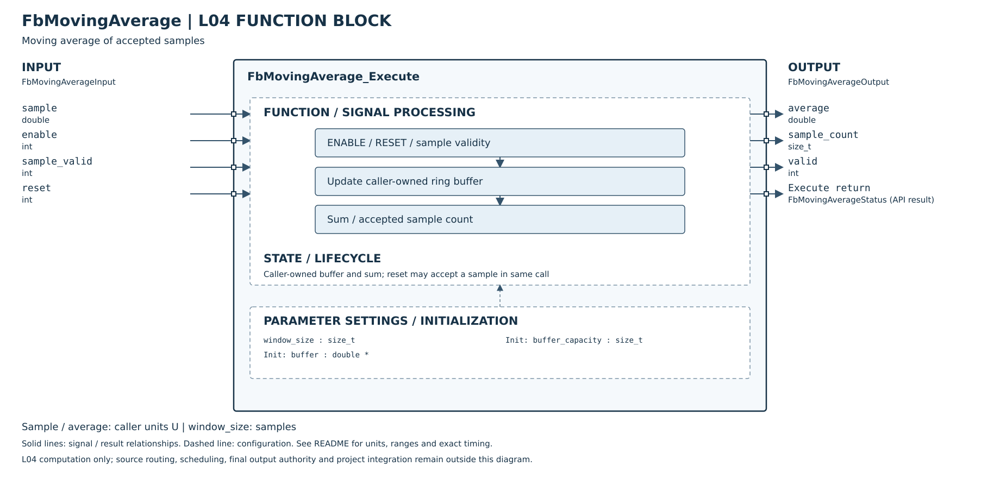

# FbMovingAverage Host Test

### 介面欄位與設定

| 類別 | 欄位 | 用途／規則 |
|---|---|---|
| 參數設定 | `window_size` | 平均視窗筆數，範圍為 `1..buffer_capacity`；執行中變更會清空舊視窗，再以新設定開始累積。 |
| 初始化 | `buffer`、`buffer_capacity` | 呼叫端提供的 `double` 陣列及容量；容量至少需等於 `window_size`，FB 不配置動態記憶體。 |
| 週期輸入 | `sample` | 本週期數值；只有 `sample_valid` 為真時才納入計算。 |
| 週期輸入 | `sample_valid` | 假時略過本週期，既有樣本不變；真但數值非有限時回報 `INVALID_INPUT`。 |
| 週期輸入 | `reset` | 清除歷史樣本；若同週期 `sample_valid` 為真，該筆成為新視窗第一筆。 |
| 輸出 | `average`、`sample_count`、`valid` | 目前視窗的平均值、有效樣本數及是否已有至少一筆樣本。 |
| 執行狀態 | `Status` | `OK`、`INVALID_ARGUMENT` 或 `INVALID_INPUT`。 |

`Init` 是一次性實例初始化；`Execute` 每個控制週期呼叫一次。`State` 與其緩衝區必須由呼叫端維持有效，且每個 FB 實例使用各自的狀態及緩衝區。


## 摘要

- 狀態：**PASS**
- 測試方式：以 GCC 嚴格 C99 選項獨立編譯 FB 與 host test，並執行測試程式。
- 編譯選項：`-std=c99 -Wall -Wextra -Werror -pedantic`
- 涵蓋：初始化及參數檢查、有效樣本累積、滑動替換、跳過無效樣本、重設、視窗尺寸變更、非有限輸入與視窗範圍錯誤。
- 未涵蓋：MCU 實機時序、長期浮點誤差特性、呼叫端錯誤配置緩衝區實際長度（C 無法檢查指標所指配置大小）。

## 詳細測項

| 測項 | 操作／輸入 | 預期結果 | 結果 |
|---|---|---|---|
| UT-01 初始化有效緩衝區 | 容量 4，提供 4 個 `double` | 回傳 `OK` 並清空狀態 | PASS |
| UT-02 初始化空指標 | state 或 buffer 為 `NULL` | 回傳 `INVALID_ARGUMENT` | PASS |
| UT-03 初始化零容量 | 容量為 0 | 回傳 `INVALID_ARGUMENT` | PASS |
| UT-04 空窗輸出 | 尚未加入樣本執行一次 | `valid=0`、樣本數 0、平均值 0 | PASS |
| UT-05 部分視窗平均 | 依序加入 3、6 | 樣本數 2，平均值 4.5 | PASS |
| UT-06 無效樣本跳過 | `sample_valid=0`，sample 為 NaN | 回傳 `OK`，歷史與平均值維持 4.5 | PASS |
| UT-07 視窗填滿 | 視窗 3 加入 9 | 樣本數 3，平均值 6 | PASS |
| UT-08 滑動替換最舊值 | 再加入 12，樣本為 6、9、12 | 平均值 9 | PASS |
| UT-09 重設並同週期取樣 | reset=1 並加入 15 | 舊樣本清除，樣本數 1、平均值 15 | PASS |
| UT-10 視窗大小變更 | 視窗由 3 改成 2，加入 -2、4 | 視為新視窗，平均值依新視窗計算為 1 | PASS |
| UT-11 非有限有效輸入 | sample 為正無限大且標示有效 | 回傳 `INVALID_INPUT`，不改變既有視窗 | PASS |
| UT-12 視窗尺寸範圍 | window_size 為 0 或大於 buffer_capacity | 回傳 `INVALID_ARGUMENT` | PASS |

## 重現方式

在 `PlatformCore` 根目錄執行：

```sh
gcc -std=c99 -Wall -Wextra -Werror -pedantic \
  -I L04_FunctionBlock/Utility \
  Tests/Unit/L04_FunctionBlock/test_fb_moving_average.c \
  L04_FunctionBlock/Utility/FbMovingAverage.c \
  -lm -o /tmp/test_fb_moving_average
/tmp/test_fb_moving_average
```

預期輸出：`FbMovingAverage host tests passed`
