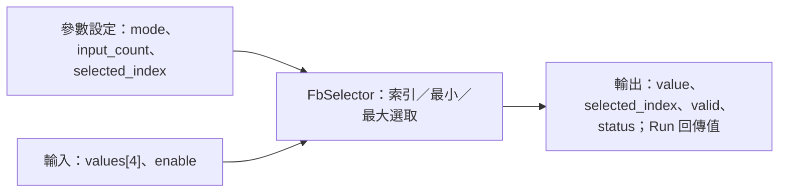

# FbSelector Host Unit Test

## FB 介面方塊圖



| 類別 | 欄位 | 用途／規則 |
|---|---|---|
| 參數設定 | `mode` | 選擇指定索引、最小值或最大值。 |
| 參數設定 | `input_count` | 有效輸入路數，範圍為 1 至 4。 |
| 參數設定 | `selected_index` | `INDEX` 模式使用，必須小於 `input_count`；極值模式不依此欄位選取。 |
| 輸入 | `values[4]` | 候選數值；僅檢查有效路數內的槽位。 |
| 輸入 | `enable` | false 時回報 `DISABLED` 並清除輸出有效旗標。 |
| 輸出 | `value`、`selected_index`、`valid` | 選取數值、來源索引及有效狀態；同值時採較小索引。 |
| 輸出 | `status`、Run 回傳值 | 狀態列出錯誤類型；Run 只有有效選取才回傳 true。 |


## 摘要

- **測試結果：** PASS
- **測試案例：** 17 項
- **測試範圍：** 索引選取、最小／最大選取、相同極值的索引規則、有效輸入數量、未使用槽、非法設定／輸入、停用、重設、空指標。
- **編譯標準：** C99；使用 `-Wall -Wextra -Werror -pedantic`
- **執行結果：** Host 測試程式結束碼為 0。
- **測試程式：** [test_fb_selector.c](../../../../../Tests/Unit/L04_FunctionBlock/test_fb_selector.c)

## 測試細則

| ID | 測試項目 | 設定／輸入 | 預期結果 | 驗證狀態 |
|---|---|---|---|---|
| UT-01 | 初始化 | 呼叫 `FbSelector_Initialize` | mode=INDEX；input_count=4；selected_index=0 | 通過 |
| UT-02 | 指定索引 | INDEX；selected_index=2；values=[5,−3,−3,8] | Run=true；value=−3；index=2；valid=true | 通過 |
| UT-03 | 取最小值及同值處理 | MINIMUM；第 2、3 路皆為 −3 | Run=true；value=−3；選較小索引 1 | 通過 |
| UT-04 | 取最大值 | MAXIMUM；values=[5,−3,−3,8] | Run=true；value=8；index=3 | 通過 |
| UT-05 | 忽略未使用槽 | input_count=3；第 4 路 value=NaN；MAXIMUM | Run=true；value=5；index=0 | 通過 |
| UT-06 | 索引超出有效數量 | input_count=3；INDEX；selected_index=3 | Run=false；status=INVALID_CONFIGURATION | 通過 |
| UT-07 | 輸入數量為零 | input_count=0 | Run=false；status=INVALID_CONFIGURATION | 通過 |
| UT-08 | 輸入數量超過上限 | input_count=5 | Run=false；status=INVALID_CONFIGURATION | 通過 |
| UT-09 | 未定義模式正值 | mode=99 | Run=false；status=INVALID_CONFIGURATION | 通過 |
| UT-10 | 未定義模式負值 | mode=−1 | Run=false；status=INVALID_CONFIGURATION | 通過 |
| UT-11 | 指定槽為 Infinity | INDEX；被選槽 value=+Infinity | Run=false；status=INVALID_INPUT | 通過 |
| UT-12 | 極值模式含 NaN | MINIMUM；有效槽 value=NaN | Run=false；status=INVALID_INPUT | 通過 |
| UT-13 | 停用 | Enable=false | Run=false；value=0；valid=false；status=DISABLED | 通過 |
| UT-14 | 重設輸出 | 呼叫 `FbSelector_Reset` | value=0；valid=false；status=DISABLED | 通過 |
| UT-15 | Config 空指標 | config=NULL | Run=false；status=INVALID_ARGUMENT | 通過 |
| UT-16 | Input 空指標 | input=NULL | Run=false；status=INVALID_ARGUMENT | 通過 |
| UT-17 | Output 空指標 | output=NULL | Run=false；不解參考或寫入空指標 | 通過 |

### 共通錯誤輸出判定

對可寫入的 Output，錯誤案例皆檢查 value 清為 0、selected_index 清為 0、valid=false，且 status 符合預期。Output 為 NULL 時檢查 Run 回傳 false。

### 尚未涵蓋的情況

- MAXIMUM 模式下出現相同最大值時，確認選較小索引。
- INDEX 模式下非選取槽為 NaN／Infinity 時是否應忽略。
- input_count=1 的 MINIMUM／MAXIMUM 模式。
- Min／Max 模式下 selected_index 欄位是否忽略的獨立測試。
- 發生錯誤後再執行有效資料，確認輸出恢復有效。

## 重現方式

在 Platform repository 根目錄執行：

```sh
cc -std=c99 -Wall -Wextra -Werror -pedantic \
  -I L04_FunctionBlock/Utility \
  L04_FunctionBlock/Utility/FbSelector.c \
  Tests/Unit/L04_FunctionBlock/test_fb_selector.c \
  -o test_fb_selector
./test_fb_selector
```
