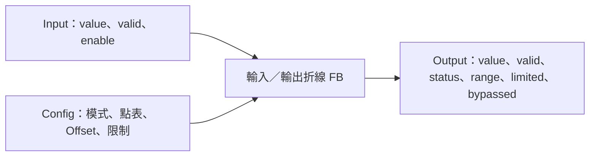

# 輸入／輸出折線模式包裝

## 摘要

已完成 L04 無狀態單訊號包裝，重用 FbLinearization 的內插與驗證。入口為 FbInputLinearization_Execute／FbOutputLinearization_Execute，宣告於 ../FbSignalLinearization.h。無硬體／Register／CKLIB 相依、無動態配置、不綁通道數；L05 路由、Register／NVM、MCU 與實體輸出尚未整合。此為專案契約，不宣稱完全複製 DTDM04。

## 引腳與模式

| 引腳 | 定義 |
|---|---|
| value | 有限 float，與表 X 相同單位 |
| valid | false 時結果無效，禁止以舊值計算 |
| enable | false 強制零／invalid／DISABLED；與 BYPASS 分開 |
| output.value／valid | 僅 OK 有效；失敗清零 |
| range | X 在表域 BELOW／WITHIN／ABOVE；旁路及失敗 UNKNOWN |
| limited | 最終輸出限制曾夾制，不含 X 域夾制 |
| bypassed | 僅輸入 BYPASS 成功時 true |
| status | 沿用 FbLinearizationStatus |

輸入模式：BYPASS 原值通過且忽略表／Offset／限制；VALUE=f(x)；DEVIATION=x+f(x)。後兩者再加可選 Offset，再套輸出限制。Deviation 的 X／Y／Offset 必須同量綱；Value 模式允許 X／Y 不同單位，Offset 跟隨 Y。

輸出模式：OFF 強制零且無效；INTERPOLATED 線性內插；STEPPED 在 Xi≤x<Xi+1 取 Yi，精確末點取末 Y。OFF 優先於數值與表驗證，enable=false 亦同；空指標檢查最優先。

## 參數設定細則

共用 FbSignalLinearizationParameters：curve.table/count/policy、offset_enabled/offset、limits_enabled/limit_low/limit_high/limit_policy。設定與輸入分開，呼叫端可用零初始化後填入模式及合法表。enabled 模式不提供隱含預設點表。

- count≥2，不設定產品固定上限；每個 X／Y 有限且 X 嚴格遞增，重複／反序拒絕。Y 可下降或非單調。
- 點表由呼叫端持有，呼叫期間不可變動；無效指標或 count 超出儲存大小無法由 C API 判斷，呼叫端負責。
- curve.policy=CLAMP／ERROR；CLAMP 取端點 Y，ERROR 回 OUT_OF_RANGE，不外插。
- Offset 可選，未開啟時忽略數值。限制可選，開啟時需有限且 low≤high；limit_policy=CLAMP／ERROR。
- 使用 double 加總，最後轉回 float；超出 float 有限範圍回 INVALID_INPUT。明確輸出夾制可先將大結果限至合法範圍；不無聲飽和至 FLT_MAX。
- 所有成功／失敗輸出均完整重設，無上一筆結果殘留。無狀態，因此不需要 Init／Reset，也沒有停用後恢復舊計時的問題。
- 參數／輸入／輸出記憶體不得重疊；多實例可共享唯讀點表並使用各自輸出，更新由外層同步。
- 單位由外層顯式換算；溫度可用 milli°C 數值或 °C，但表、值與 Offset 必須一致。float 不代表所有量程保證任意 0.001°C 精度。禁止 fast-math，繼承核心浮點契約。

## DTDM04 參數轉接原則

輸入 enable=0 對應 BYPASS（FB 本身仍 enable=true）；enable=1 對應 VALUE／DEVIATION、offset_enabled=false；enable=2 對應同模式且 offset_enabled=true。此 Offset 次序為本專案選擇。真正停量測／訊號不許可應傳 valid=false 或 enable=false，不混用旁路。

輸出 Operation=0／1／2 對應 OFF／INTERPOLATED／STEPPED；來源功能或通道 Off 由 L05 整理成 OFF。單位標記與來源枚舉不進入數學 FB。Low／High 是否是插值端點須由產品契約決定；此 API 明確區分表端點與最終限制，不自動插入 Low／High。

整組 Pending／Apply 應先驗證模式、點表、單位及來源一致性，再切換不可變設定；本包裝每次執行驗證數學設定，不負責儲存或原子交易。

測試：[Host 細則](HOST_TEST.md)。
